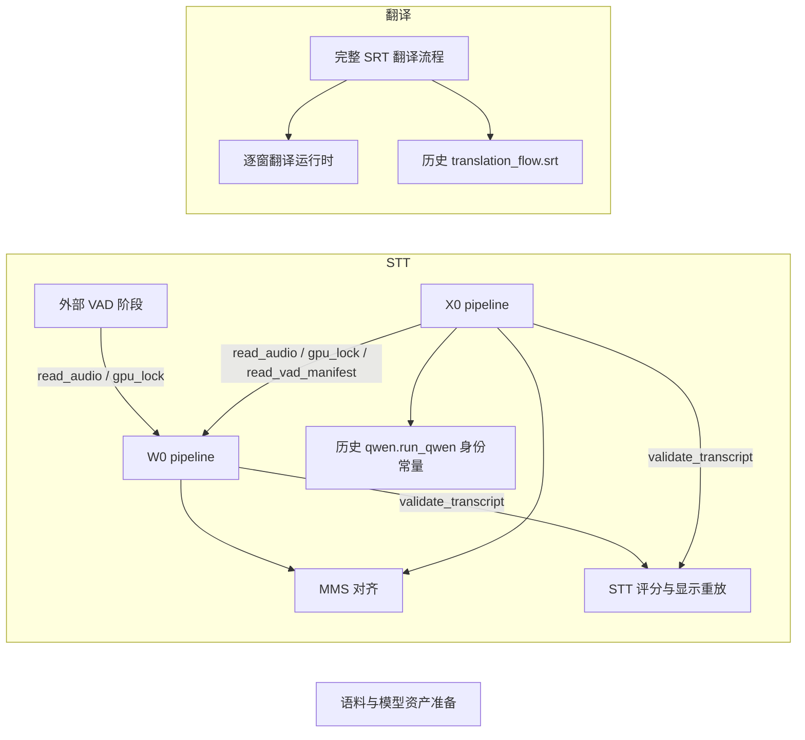
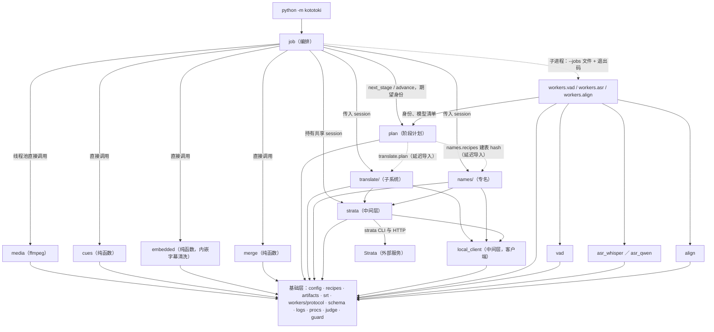

# 当前架构总览

仓库有一个产品包 `kototoki/`（双语字幕批量流水线，入口 `python -m kototoki`）与一组研究／demo 入口（`experiments/`、`kototoki_eval/`）。
本页是理解当前系统的入口："当前"指同一仓库版本已实现的结构，不代表全部环境已验收。现行决定与基线身份看 [CURRENT.md](../adr/CURRENT.md)，本页不复述。
阅读顺序：本页 → [模块边界](module-boundaries.md) → 受影响的模块页 → 源码与测试。

## 模块地图

每个模块一篇完整的当前说明，模板见[文档维护规则](../agents/documentation.md#模块页模板)；逻辑职责不要求与源码包一一对应。

### 产品包

| 模块页 | 代码 | 职责 |
| --- | --- | --- |
| [批次编排](modules/batch-orchestration.md) | `kototoki/__main__.py`、`kototoki/job.py` | 唯一入口：扫描、阶段 × 整批调度、续跑、锁、发布到源文件旁 |
| [运行日志、进程原语与 worker 子进程](modules/run-logging-and-processes.md) | `kototoki/logs.py`、`kototoki/procs.py` | 运行日志格式与规则、锁文件与 Job Object、GPU worker 启动与崩溃判定 |
| [阶段计划](modules/stage-plan.md) | `kototoki/plan.py` | 阶段链、各阶段产物与输入、模型清单、期望身份、下一个要跑的阶段 |
| [产物契约](modules/artifact-contract.md) | `kototoki/artifacts.py`、`kototoki/workers/protocol.py`、`kototoki/srt.py` | 工作目录与产物身份、匹配跳过、原子替换、失败与发布记录、worker `--jobs` 协议 |
| [配置、配方与媒体提取](modules/config-and-media.md) | `kototoki/config.py`、`kototoki/recipes.py`、`kototoki/media.py`、`kototoki/embedded.py` | 读配置、配方常量与 `recipe_hash`、选音轨与派生 WAV、内嵌字幕抽取与清洗 |
| [配置参考](modules/config-reference.md) | `kototoki/config.py`、`kototoki.toml.example` | `kototoki.toml` 的全部键、默认值、校验，哪些键进产物身份 |
| [STT worker](modules/stt-workers.md) | `kototoki/workers/`、`kototoki/vad.py`、`kototoki/align.py`、`kototoki/schema.py` | GPU worker 壳的共用规则（jobs、模型核对、身份、失败分级）、VAD 与对齐 |
| [STT ASR](modules/stt-asr.md) | `kototoki/asr_whisper.py`、`kototoki/asr_qwen.py`、`kototoki/judge.py`、`kototoki/guard.py` | w0／x0 逐窗转写、cross 交叉打分裁判、w0 整窗复读守卫 |
| [日文 cue](modules/japanese-cues.md) | `kototoki/cues.py` | 字符时间回填并切成日文 cue；时间轴上唯一加 `offset_s` 的地方 |
| [Strata 服务与共享 session](modules/strata-session.md) | `kototoki/strata.py`、`kototoki/local_client.py` | Strata 起停、身份核对、专家区检查、整批共用的 session 与启动额度、回环客户端 |
| [专名一致性](modules/name-consistency.md) | `kototoki/names/` | 在共享 session 上把整份 `ja.srt` 一次建成专名表；失败写空表照常翻译 |
| [翻译子系统与双语合并](modules/translation-subsystem.md) | `kototoki/translate/`、`kototoki/merge.py` | 产品翻译配方：切包、请求、专名注入、按批次续跑、10→5→1 降级；中日两行合并 |

### 研究与 demo

| 模块页 | 代码 | 职责 |
| --- | --- | --- |
| [外部 VAD 阶段](modules/vad-stage.md) | `experiments/vad_comparison/vad_stage.py`、`experiments/w0_demo/vad_candidates.py` | 独立环境跑一个 VAD 候选，产出 VAD manifest（W0／X0 窗口的唯一来源） |
| [W0 pipeline](modules/w0-pipeline.md) | `experiments/w0_demo/` | 单进程 VAD 回放 → faster-whisper ASR → MMS |
| [X0 pipeline](modules/x0-pipeline.md) | `experiments/x0_demo/` | 父进程编排 plan／asr／align 三个隔离子进程：Qwen ASR → MMS |
| [MMS 对齐](modules/mms-alignment.md) | `experiments/w0_demo/alignment.py` | W0／X0 共用的日语 CTC 强制对齐、字符映射与 `text_only` 记账 |
| [STT 评分与显示重放](modules/stt-evaluation.md) | `kototoki_eval/`、`experiments/display/replay.py` | 后端无关的转写 JSON 契约、CER 与时间评分、最小 SRT 显示重放 |
| [语料与模型资产准备](modules/corpus-and-assets.md) | `experiments/corpus/`、`experiments/provision/` | 冻结语料窗口与参考、生成样本 PCM；联网获取固定 revision 的模型资产 |
| [逐窗翻译运行时](modules/translation-runtime.md) | `experiments/translation_demo_runtime.py`、`experiments/translation_demo/` | 托管本地 llama.cpp server，按冻结窗口生成并机械校验译文（H0 模型与采样） |
| [完整 SRT 翻译流程](modules/translation-srt-flow.md) | `experiments/translation_v3/` | v3 配方、批次、可续跑生成与 `translate-srt` 整片交付（`dp10-cut`） |
| [当前 STT 基准线](stt-candidate-pipelines.md) | — | W0／X0 的组件选型与基线身份（冻结的权威表） |

其余实验包（历史实验、各研究轮次）不建模块页，逐包状态见 [experiments 包登记](../../experiments/INDEX.md)；复现历史时按各自 README 使用冻结配置与旧身份，不把其入口当作当前基线。

## 按任务找模块页

| 任务 | 从这里继续 |
| --- | --- |
| 改配置键、默认值或校验 | [配置参考](modules/config-reference.md) → [配置、配方与媒体提取](modules/config-and-media.md) |
| 改音轨选择、WAV 派生或内嵌字幕路径 | [配置、配方与媒体提取](modules/config-and-media.md) |
| 改 VAD 分窗、对齐或 worker 的 jobs 约定 | [STT worker](modules/stt-workers.md) → [产物契约](modules/artifact-contract.md) |
| 改 w0／x0 转写、cross 裁判或复读守卫 | [STT ASR](modules/stt-asr.md) |
| 改日文 cue 的切分与显示规则 | [日文 cue](modules/japanese-cues.md) |
| 改翻译配方、降级或双语合并 | [翻译子系统与双语合并](modules/translation-subsystem.md) |
| 改专名建表 | [专名一致性](modules/name-consistency.md) |
| 改 Strata 起停、显存检查或 session | [Strata 服务与共享 session](modules/strata-session.md) |
| 加阶段、改产物身份或跳过判定 | [阶段计划](modules/stage-plan.md) → [产物契约](modules/artifact-contract.md) |
| 改调度、续跑、锁或发布 | [批次编排](modules/batch-orchestration.md) |
| 改日志、进程锁或 worker 启动 | [运行日志、进程原语与 worker 子进程](modules/run-logging-and-processes.md) |
| 跨模块改动、移动或改名产品符号 | [模块边界](module-boundaries.md) → [技术设计](../specs/bilingual-subtitle-pipeline.md) |
| 运行、比较或修改 W0／X0 基线 | [标准基线测试指南](../guides/baseline-testing.md) → [W0 pipeline](modules/w0-pipeline.md)／[X0 pipeline](modules/x0-pipeline.md) → [规格索引](../specs/INDEX.md)的 demo 契约 |
| 改转写 JSON 字段、评分或字幕显示 | [STT 评分与显示重放](modules/stt-evaluation.md) → [评测器契约](../testing/evaluator-contract.md) |
| 研究侧翻译（逐窗、整片 SRT） | [逐窗翻译运行时](modules/translation-runtime.md)、[完整 SRT 翻译流程](modules/translation-srt-flow.md) |

## 依赖与装配

研究侧（箭头从使用方指向被依赖方）：

文件契约未画出：外部 VAD 阶段写出的 manifest 由 W0／X0 读取；W0／X0 的 `result.json` 由评分 CLI 读取；语料准备产出 WAV 与参考 JSON，各 demo 只读文件，不导入语料模块。

产品包 `kototoki/`（进程边界用虚线）：

依赖只允许向下。硬规则、责任边界与接缝在[模块边界](module-boundaries.md#依赖方向)：产品代码不导入研究代码，研究侧可以导入产品符号；产品符号移动或改名时，同一提交里改研究侧的导入行。

装配入口（全部从仓库根目录启动，加载模型的都是 GPU 重任务）：

| 入口 | 解释器 | 模块 |
| --- | --- | --- |
| `python -m kototoki [kototoki.toml]`；默认配置的便捷入口 `just subtitles <目录>`（`scripts/subtitles.py`，写只含 `input_dir` 的配置到 `.local/run-configs/` 再调同一入口；测试 `tests/core/test_subtitles_script.py`） | 根 `.venv`；GPU 阶段以同一解释器起子进程 worker；建表与翻译共用本机 Strata（须预先安装并备好模型） | [批次编排](modules/batch-orchestration.md) |
| `python -m experiments.vad_comparison.vad_stage` | `.local/envs/vad-pyannote-gpu-v1` | 外部 VAD 阶段 |
| `python -m experiments.w0_demo.run` | `.local/envs/whisper-latest` | W0 pipeline |
| `python -m experiments.x0_demo.run`／`just x0-demo` | 父进程 `legacy` 解释器，子进程 `qwen-hf-final` 与 `whisper-latest` | X0 pipeline |
| `python -m kototoki_eval`、`python -m experiments.display.replay` | 根 `.venv` | STT 评分与显示重放（离线） |
| `just translation-baseline`／`just translation-demo` | `legacy` 解释器（不是根 `.venv`）+ 本机 llama-server | 逐窗翻译运行时 |
| `just translation-srt` | `legacy` 解释器 + 本机 llama-server | 完整 SRT 翻译流程 |

产品入口的用法见仓库 [README](../../README.md#双语字幕流水线)；基线的完整命令序列见[标准基线测试指南](../guides/baseline-testing.md)。

## 系统不变量

- 研究入口：音频、转写与译文只写入 `.local/` 下新建的私有运行目录，已有目录或输出拒绝覆盖；控制台只输出状态、计数与耗时。见[模块边界：状态与契约](module-boundaries.md#状态与契约)。
- 产品入口：工作目录 `work_dir` 按产物身份续跑与原地替换；最终只发布源文件旁的 `ja-zh.srt`，已存在即跳过、没有覆盖开关。目录位置的限制见[批次编排](modules/batch-orchestration.md)。
- 产品产物的跳过与续跑只看产物身份（上游 SHA256、配方 hash、模型 SHA256，不含绝对路径）。见[产物契约](modules/artifact-contract.md)。
- ASR 与 MMS 只在 CUDA 上运行，失败不回退 CPU；VAD 设备由外部阶段显式记录，产品 VAD 固定 `cuda:0`。见 [MMS 对齐](modules/mms-alignment.md#当前行为规格)、[W0 pipeline](modules/w0-pipeline.md#当前行为规格)。
- 识别全文的每个字符在 `units` 中恰好出现一次；缺时间的字符保留为 `text_only`，不删除、不伪造时间。
- W0／X0 的识别窗口以 VAD manifest 的源坐标为准，有成对整数 `start_sample/end_sample` 时 ASR 与 MMS 用同一整数裁剪。见[外部 VAD 阶段](modules/vad-stage.md#接口与依赖)。
- 产品时间轴：派生 WAV 的 sample 0 等于输入 0 秒（`offset_s` 恒为 0），各阶段 JSON 一律 WAV 本地秒，cue 时间只在日文 cue 加一次 offset。见[模块边界：产品包的责任边界](module-boundaries.md#产品包的责任边界)。
- 推理期间不联网、不下载；模型获取只经[语料与模型资产准备](modules/corpus-and-assets.md)。
- 同一时刻只有一个持 `.local/gpu.lock` 的 GPU 作业；不抢占、不删除活跃锁。见[模块边界：并发与生命周期](module-boundaries.md#并发与生命周期)。
- 运行身份（recipe、recipe_hash、模型 SHA256、源码哈希）随结果冻结；改变行为须另建身份，不复用旧分数。

重要取舍见[决定索引](../adr/INDEX.md)，证据见[调研索引](../research/INDEX.md)；两者不覆盖当前正文。
