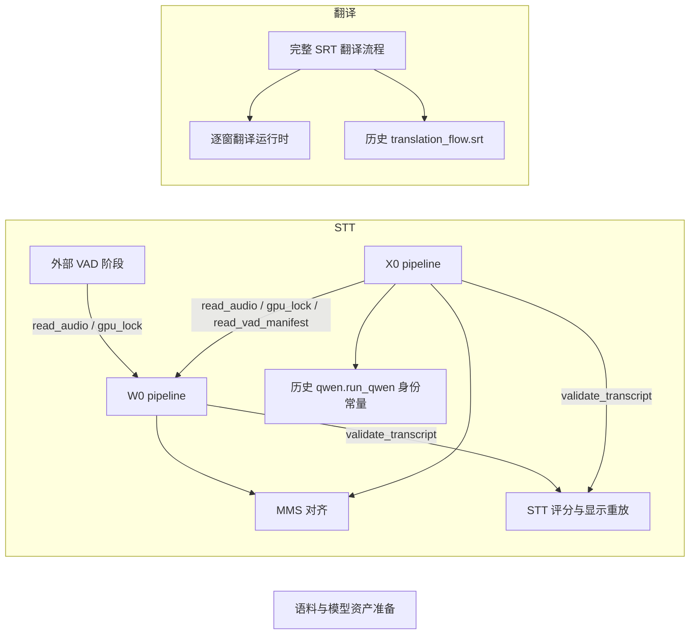
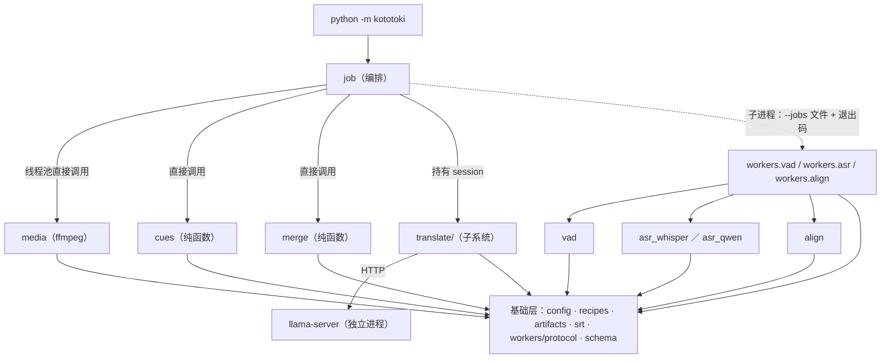

# 当前架构总览

仓库有一个正式产品形态与一组研究／demo 入口。产品包 `kototoki/` 是双语字幕批量流水线（[技术设计](../specs/bilingual-subtitle-pipeline.md)、[ADR-0007](../adr/0007-bilingual-subtitle-pipeline-architecture.md)）：入口 `python -m kototoki [kototoki.toml]` 从一批日语视频生产日文、中文与中日双语 SRT，STT 默认 W0、可选 X0，翻译用产品配方 `b10-joint-degrade-v1`。其余可复用代码是一组以 `python -m` 启动的离线实验入口，各自在 `.local/` 下新建私有运行目录并冻结源码、输入与模型身份。研究侧提供两条日语 STT 基线 demo（W0：faster-whisper，X0：Qwen-ASR；二者共用外部新 Pyannote VAD 阶段与 MMS CTC 对齐）、与推理后端无关的转写评分与显示重放，以及独立的 Hy-MT2 字幕翻译运行时和完整 SRT 流程基线 `b10-joint`。组件选型与基线身份见[当前 STT 基准线](stt-candidate-pipelines.md)，翻译基线见 [ADR-0005](../adr/0005-apex-i-compact-translation-baseline.md)／[ADR-0006](../adr/0006-b10-joint-translation-flow-baseline.md)。

本页是理解当前系统的入口，覆盖正式代码；"当前"指同一仓库版本的已实现结构，不代表全部环境已验收。阅读顺序：本页 → [模块边界](module-boundaries.md) → 受影响的模块页 → 源码与测试。

## 模块地图

每模块一篇完整当前说明，模板见[文档维护规则](../agents/documentation.md#模块页模板)。逻辑职责不要求与源码包一一对应。

| 模块 | 职责与主要状态所有者 | 实际位置 |
| --- | --- | --- |
| [外部 VAD 阶段](modules/vad-stage.md) | 在独立环境运行一个 VAD 候选（当前基线为新 Pyannote），产出带输入身份与整数源窗口的 VAD manifest；manifest 文件是 W0／X0 窗口的唯一来源 | `experiments/vad_comparison/vad_stage.py`、`experiments/w0_demo/vad_candidates.py` |
| [W0 pipeline](modules/w0-pipeline.md) | 单进程 VAD 回放 → faster-whisper ASR → MMS；拥有 `.local/w0-demo/<run>/` 与 `.local/gpu.lock` 的简单锁实现 | `experiments/w0_demo/`（`run.py`、`pipeline.py`、`asr.py`、`vad.py`） |
| [X0 pipeline](modules/x0-pipeline.md) | 父进程编排 plan／asr／align 三个隔离子进程：分段计划 → Qwen ASR → MMS；拥有 `.local/x0-demo/<run>/` | `experiments/x0_demo/` |
| [MMS 对齐](modules/mms-alignment.md) | W0／X0 共用的 MMS-1b-all 日语 CTC 强制对齐、字符映射与 `text_only` 记账 | `experiments/w0_demo/alignment.py` |
| [STT 评分与显示重放](modules/stt-evaluation.md) | 后端无关的转写 JSON 契约（`validate_transcript`）、完整分母 CER／时间评分、最小 SRT 显示重放 | `kototoki_eval/`、`experiments/display/replay.py` |
| [语料与模型资产准备](modules/corpus-and-assets.md) | 冻结私有语料窗口与参考、生成样本精确 PCM 输入；联网获取固定 revision 的模型资产，与离线推理分离 | `experiments/corpus/`、`experiments/provision/`、`experiments/w0_demo/prepare_assets.py` |
| [逐窗翻译运行时](modules/translation-runtime.md) | 托管一个本地 llama.cpp server（loopback），按冻结窗口 JSONL 生成并机械校验译文；ADR-0005 模型／采样基线入口 | `experiments/translation_demo_runtime.py`、`experiments/translation_demo/`、`experiments/translation_monitor.py` |
| [完整 SRT 翻译流程](modules/translation-srt-flow.md) | v3 配方、批次、可续跑生成与 `translate-srt` 整片交付；ADR-0006 `b10-joint` 基线；拥有 v3 格式 `.local/gpu.lock` 与 v3 产物根目录 | `experiments/translation_v3/` |
| [产物契约](modules/artifact-contract.md) | 双语字幕流水线共用的工作目录与产物身份、匹配跳过与原子替换、`failure.json`／`published.json` 与覆盖规则、worker `--jobs` 协议与 `failed_windows`、SRT 读写 | `kototoki/artifacts.py`、`kototoki/workers/protocol.py`、`kototoki/srt.py` |
| [配置、配方与媒体提取](modules/config-and-media.md) | 双语字幕流水线的 `kototoki.toml` 读取与路径解析、STT／cue／媒体配方常量与 `recipe_hash`、ffprobe 选音轨、流复制原始音轨、从容器派生 16 kHz WAV（定义时间轴零点，`offset_s` 恒为 0） | `kototoki/config.py`、`kototoki/recipes.py`、`kototoki/media.py` |
| [日文 cue](modules/japanese-cues.md) | 双语字幕流水线中把 `align.json` 字符时间回填（插值、外推、整窗 `fallback`）并切成日文 cue 的纯函数，产出 `ja-cues.json` payload 与 `ja.srt` 文本；时间轴上唯一加 `offset_s` 的地方 | `kototoki/cues.py` |
| [STT worker](modules/stt-workers.md) | 双语字幕流水线的三个 GPU 阶段：Pyannote VAD 分窗（`vad.json`）、w0／x0 逐窗转写（`asr.json`，窗口级 `failed_windows`，x0 触顶窗口置空）、MMS 字符级对齐（`align.json`，W0 `result.json` 结构）；推理模块按窗口推理，worker 壳管身份、产物与 CUDA 粘性错误退出码 | `kototoki/vad.py`、`asr_whisper.py`、`asr_qwen.py`、`align.py`、`schema.py`、`kototoki/workers/{vad,asr,align,gpu}.py` |
| [批次编排](modules/batch-orchestration.md) | 双语字幕流水线的唯一入口 `python -m kototoki`：扫描与镜像、阶段 × 整批调度（线程池 extract、GPU 阶段子进程 worker、进程内 ja-cues／翻译）、续跑与按文件重启、输出目录锁与 `.local/gpu.lock`、Job Object、三份 SRT 一起发布；拥有 `<output_dir>/.work/` 的锁、运行日志与发布记录 | `kototoki/__main__.py`、`kototoki/job.py` |
| [翻译子系统与双语合并](modules/translation-subsystem.md) | 双语字幕流水线的翻译：整批共用一个受管 llama-server session、`b10-joint` 批次请求（与 v3 逐字节相同）、按批次落盘与续跑、基础设施失败重启即新 session；中日两行合并的纯函数 | `kototoki/translate/`、`kototoki/merge.py` |
| 历史实验代码（冻结或只作回归参考） | 不建模块页；复现历史时按各自 README 使用冻结配置与旧身份，见下方列表 | 见下 |

历史实验代码：[whisper](../../experiments/whisper/README.md)、[qwen](../../experiments/qwen/README.md)、[x0_flow](../../experiments/x0_flow/README.md)、[japanese_ctc](../../experiments/japanese_ctc/README.md)、[framework_equivalence](../../experiments/framework_equivalence/README.md)、[components](../../experiments/components/README.md)、[crisp](../../experiments/crisp/README.md)、[asr_candidates](../../experiments/asr_candidates/README.md)、[vad_comparison](../../experiments/vad_comparison/README.md)（除 `vad_stage.py` 外）、[fullfilm_comparison](../../experiments/fullfilm_comparison/README.md)、[performance](../../experiments/performance/README.md)、`experiments/analysis/`；翻译侧 [translation_flow](../../experiments/translation_flow/README.md)（v1／v2，v2 冻结）、[translation_eval](../../experiments/translation_eval/README.md)、[translation_judge](../../experiments/translation_judge/README.md)、[translation_compat](../../experiments/translation_compat/README.md)、[translation_corpus](../../experiments/translation_corpus/README.md)、[translation_four_quantization](../../experiments/translation_four_quantization/README.md)、[translation_v4](../../experiments/translation_v4/README.md)，以及 `experiments/` 根下 `translation_*.py`、`run_experiment.py`、`run_round2.py`、`x0_flow_evaluate.py` 等单文件脚本。其中当前模块仍在导入的少数符号见[模块边界](module-boundaries.md#依赖方向)。

## 依赖与装配

产品包 `kototoki/`（进程边界用虚线）：

依赖只允许向下；四条硬规则（编排不导入推理模块、推理模块互不导入、基础层不依赖 torch／ffmpeg／网络、产品包不导入 `experiments.*`）与责任边界见[模块边界](module-boundaries.md#依赖方向)。产品与研究入口之间没有导入关系：产品代码从实验代码复制而来，不引用。

箭头从使用方指向被依赖方。VAD manifest、`result.json`、参考 JSON 等文件契约在图中未画出：外部 VAD 阶段写出的 manifest 由 W0／X0 读取；W0／X0 的 `result.json` 由评分 CLI 读取；语料准备产出 WAV 与参考 JSON，各 demo 只读取文件，不导入语料模块。

装配入口（全部从仓库根目录启动，模型加载均为 GPU 重任务）：

| 入口 | 解释器 | 模块 |
| --- | --- | --- |
| `python -m kototoki [kototoki.toml]` | 根 `.venv`（统一 CUDA 12.8 环境），GPU 阶段以同一解释器起子进程 worker；翻译另起本机 llama-server | [批次编排](modules/batch-orchestration.md)（产品入口；配置样例 `kototoki.toml.example`） |
| `python -m experiments.vad_comparison.vad_stage` | `.local/envs/vad-pyannote-gpu-v1` | 外部 VAD 阶段 |
| `python -m experiments.w0_demo.run` | `.local/envs/whisper-latest` | W0 pipeline |
| `python -m experiments.x0_demo.run`／`just x0-demo` | 根 `.venv`，子进程用 `qwen-hf-final` 与 `whisper-latest` | X0 pipeline |
| `python -m kototoki_eval`、`python -m experiments.display.replay` | 根 `.venv` | STT 评分与显示重放（离线） |
| `just translation-baseline`／`just translation-demo` → `experiments.translation_demo_runtime` | 根 `.venv` + 本机 llama-server | 逐窗翻译运行时 |
| `just translation-srt` → `experiments.translation_v3 translate-srt --recipe b10-joint` | 根 `.venv` + 本机 llama-server | 完整 SRT 翻译流程 |

产品入口的使用方式见仓库 [README](../../README.md#双语字幕流水线)；基线的完整命令序列见[标准基线测试指南](../guides/baseline-testing.md)。

## 系统不变量

- 音频与转写／译文只写入 `.local/` 下新建的私有运行目录，已有目录或输出拒绝覆盖；控制台只输出状态、计数与耗时。见[模块边界：状态与契约](module-boundaries.md#状态与契约)。产品例外：`python -m kototoki` 写入用户配置的 `output_dir`（不得位于仓库内，`.local/` 除外，也不得位于输入目录内），工作目录 `.work/` 按产物身份续跑与原地替换，最终 SRT 按 `published.json` 的覆盖规则替换，见[批次编排](modules/batch-orchestration.md)。
- ASR 与 MMS 只在 CUDA 上运行，失败不回退 CPU；VAD 设备由外部阶段显式记录。见 [MMS 对齐](modules/mms-alignment.md#当前行为规格)、[W0 pipeline](modules/w0-pipeline.md#当前行为规格)。
- 识别全文的每个字符在 `units` 中恰好出现一次；缺时间的字符保留为 `text_only`，不删除、不伪造时间。见 [MMS 对齐](modules/mms-alignment.md#当前行为规格)。
- W0／X0 的识别窗口以 VAD manifest 的源坐标为准，有成对整数 `start_sample/end_sample` 时 ASR 与 MMS 使用同一整数裁剪。见[外部 VAD 阶段](modules/vad-stage.md#接口与依赖)。
- 推理期间不联网、不下载；模型获取只经[语料与模型资产准备](modules/corpus-and-assets.md)。
- 同一时刻只有一个持 `.local/gpu.lock` 的 GPU 作业；不抢占、不删除活跃锁。见[模块边界：并发与生命周期](module-boundaries.md#并发与生命周期)。
- 运行身份（recipe、recipe_hash、模型 SHA256、源码哈希）随结果冻结；改变行为须另建身份，不复用旧分数。
- 产品时间轴：派生 WAV 的 sample 0 等于视频 0 秒（`offset_s` 恒为 0），各阶段 JSON 一律 WAV 本地秒，cue 时间只在日文 cue 加一次 offset；编排、翻译、合并不做时间换算。产品 VAD 固定 `cuda:0`。见[配置、配方与媒体提取](modules/config-and-media.md)、[模块边界：产品包的责任边界](module-boundaries.md#产品包的责任边界)。
- 产品产物的跳过与续跑只看产物身份（上游 SHA256、配方 hash、模型 SHA256，不含绝对路径）；三份最终 SRT 一起发布，用户改动过的最终文件在非 `force` 时不覆盖。见[产物契约](modules/artifact-contract.md)。

## 按任务阅读

| 任务 | 从这里继续 |
| --- | --- |
| 运行或比较当前 W0／X0 基线 | [标准基线测试指南](../guides/baseline-testing.md) → [W0 pipeline](modules/w0-pipeline.md)／[X0 pipeline](modules/x0-pipeline.md) |
| 替换或调整 VAD、分段窗口 | [外部 VAD 阶段](modules/vad-stage.md) → [W0 契约](../specs/w0-reusable-demo.md)／[X0 契约](../specs/x0-reusable-demo.md) |
| 修改 W0 特征、解码或 ASR | [W0 pipeline](modules/w0-pipeline.md) → [W0 契约](../specs/w0-reusable-demo.md) |
| 修改 X0 分段、Qwen 输入或子进程编排 | [X0 pipeline](modules/x0-pipeline.md) → [X0 契约](../specs/x0-reusable-demo.md) |
| 修改 CTC 对齐（同时影响 W0 与 X0） | [MMS 对齐](modules/mms-alignment.md) |
| 改转写 JSON 字段、评分或字幕显示 | [STT 评分与显示重放](modules/stt-evaluation.md) → [评测器契约](../testing/evaluator-contract.md) |
| 准备新语料窗口或获取模型 | [语料与模型资产准备](modules/corpus-and-assets.md) |
| 逐窗翻译、换模型或采样配置 | [逐窗翻译运行时](modules/translation-runtime.md) → [ADR-0005](../adr/0005-apex-i-compact-translation-baseline.md) |
| 整片 SRT 翻译或新流程配方 | [完整 SRT 翻译流程](modules/translation-srt-flow.md) → [ADR-0006](../adr/0006-b10-joint-translation-flow-baseline.md) |
| 回归、benchmark 或比较改动后的 W0 | [W0 demo 验证](../testing/2026-10-05-w0-demo-validation.md)、[STT 评估方法](../testing/stt-evaluation.md) |
| 回归当前 X0 实现 | [X0 demo 验证](../testing/2026-10-05-x0-demo-validation.md) |
| 理解 X0 流程的采纳依据与质量主张的区别 | [ADR-0002](../adr/0002-x0-demo-flow.md) |
| 修改双语字幕流水线（产品包 `kototoki/`） | [模块边界](module-boundaries.md)（依赖方向、产品包的责任边界与接缝）→ 受影响的产品模块页 → [技术设计](../specs/bilingual-subtitle-pipeline.md) |
| 复现历史实验结果 | 模块地图下方的历史实验 README；不要把其入口当作当前基线 |

重要取舍见 `../adr/`，证据见[调研索引](../research/INDEX.md)；两者不覆盖当前正文。
