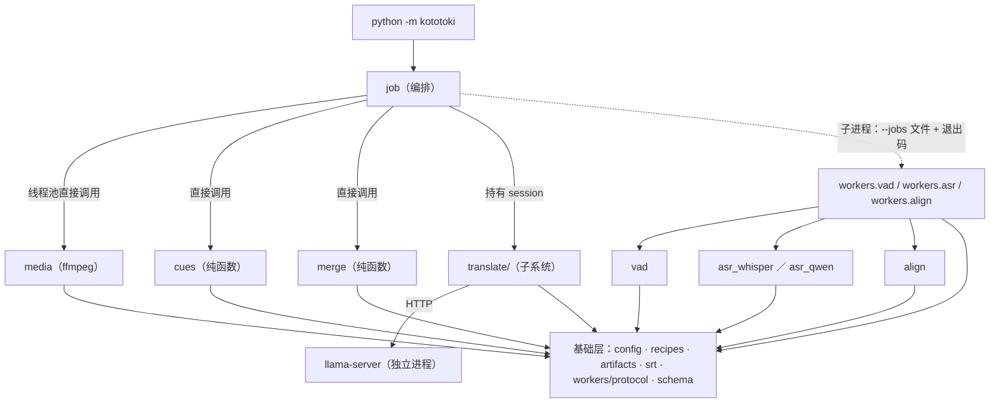

# 双语字幕流水线：目标架构

状态：设计（2026-10-14 定稿，基于票据 00、01 已交付的接口）。本页描述产品包 `kototoki/` 的目标模块划分、各模块接口、依赖方向与接缝；行为规格在[技术设计](../specs/bilingual-subtitle-pipeline.md)，取舍在 [ADR-0007](../adr/0007-bilingual-subtitle-pipeline-architecture.md)，本页不复述。已实现的部分以模块页与[模块边界](module-boundaries.md)为准，本页只链接。

吸收规则：每张票据交付时把下文模块清单中对应行的"状态"改为模块页链接；票据 08 收口时，本页的依赖图与不变量并入[架构总览](INDEX.md)，责任归属并入模块边界，然后删除本页，模块页的"变更与决策来源"记录吸收位置。

术语（本页用法）：**模块**指有接口与实现的任何单位，不限于源码包；**接口**指调用方正确使用该模块必须知道的全部事实，包括不变量、顺序约束、失败方式，不只是函数签名；**接缝**指可以在不改调用处的前提下替换行为的位置；**适配器**指在接缝处满足接口的具体实现；**深**指小接口后面藏着大量行为。

## 分层与依赖方向

箭头从使用方指向被依赖方；虚线是进程边界。依赖只允许向下，且有四条硬规则：

- **编排层不导入任何推理模块。** `job` 只以 `sys.executable -m kototoki.workers.<stage> --jobs <path>` 启动阶段 worker，与它们的全部通信是 jobs 文件、工作目录里的产物和退出码。票据 06 的禁止导入测试（`torch`、`ctranslate2`、`faster_whisper`、`transformers`、`pyannote`、`torchaudio`、`torchcodec`、任何 `experiments.*`）是这条规则的守门员。
- **推理模块互不导入。** `vad`、`asr_*`、`align` 只依赖基础层，各自在独立进程里加载模型；阶段之间只经产物文件交接。
- **基础层不依赖 torch、ffmpeg、网络与上层。** 它是所有离线测试的根基，编排器可以直接导入。
- **产品包不导入 `experiments.*`。** 历史实现只复制不引用，冻结证据保持只读；`kototoki_eval/` 继续承担评分，产品侧的 `validate_transcript` 复制到 `kototoki/schema.py`（票据 03）。

## 模块清单

"接口"一列写调用方必须知道的全部事实，"实现"一列写藏在接口后面、调用方不需要知道的事。

| 模块 | 接口 | 实现（调用方不需要知道） | 位置 | 状态 |
| --- | --- | --- | --- | --- |
| 编排 | `run(config) -> Summary`；输出目录锁与 GPU 锁冲突各有专用退出码；运行日志只含进度、计数与耗时 | 扫描与大小采样稳定性、镜像与短 id、扫描阶段的发布前置判定、CPU 阶段产物（`probe.json`、`ja-cues.json`、`ja.srt`、`zh.srt`、`ja-zh.srt`）的身份包装与写入、阶段 × 整批调度、worker 增量结果判读与按文件重启、两把锁与 Job Object、无语音捷径、三份 SRT 一起发布、`failure.json` 清理、子进程环境（`PYTHONUTF8=1`、离线变量、共用 `.work/cache/`） | `kototoki/__main__.py`、`job.py` | 票据 06 |
| worker 协议 | `run_worker(jobs_path, start)`：worker 只提供"启动一次、处理一个文件"的回调；退出码 0／1／2 的含义；`fail_window`／`retained_text` 的 `failed_windows` 写法 | jobs 文件解析、增量落盘、进度行、单文件异常隔离、`FatalWorkerError` 到退出码 2 的映射 | `kototoki/workers/protocol.py` | [产物契约](modules/artifact-contract.md) |
| 产物契约 | 四组函数：身份（`video_identity`／`derived_identity`／`is_current`）、路径（`register_work_dir`／`translate_run_dir`／`final_srt_paths`）、写入（`write_artifact`／`write_failure`）、发布（`publish_blockers` → `record_published` → 移动，顺序固定）；坐标约定是接口的一部分，调用方不得自行换算 | 短 id 与碰撞检测、ffprobe 指纹字段、模型哈希 size+mtime 缓存、原子写与 Windows 重试、`previous_sha256` | `kototoki/artifacts.py` | [产物契约](modules/artifact-contract.md) |
| SRT | `parse_srt`／`read_srt`／`format_srt`／`write_srt`；毫秒取整 `floor(x*1000+0.5)`；零条目合法 | 严格解析规则、`<sha8>-cue-<n>` 别名（供翻译移植保持请求字节） | `kototoki/srt.py` | [产物契约](modules/artifact-contract.md) |
| 配置与配方 | `load(path) -> Config`；路径解析规则（用户相对路径按配置文件目录，默认相对路径按仓库根）；未知键报错；各阶段 `recipe_hash` 常量 | TOML 读取、默认填充、`pan` 常量与重采样参数进 hash | `kototoki/config.py`、`recipes.py`（不含翻译配方） | [配置、配方与媒体提取](modules/config-and-media.md) |
| 媒体 | `probe(path, config) -> Probe`、`extract(path, work_dir, probe, config) -> Extract`（`config` 提供 ffmpeg／ffprobe 路径与音轨语言偏好）；不支持的声道布局、ffmpeg 失败与解码截断抛 `MediaError`；唯一不变量：派生 WAV 的 sample 0 等于视频 0 秒，时长已对视频流校验，`offset_s` 恒为 0 | 音轨选择与语言标签归一化、容器映射、`pan` 下混常量、`aresample=async=1:first_pts=0`、verbose 日志落盘 | `kototoki/media.py` | [配置、配方与媒体提取](modules/config-and-media.md) |
| VAD | 加载一次、对内存波形推理一次，返回整数样本窗口与子段（WAV 本地坐标）；设备固定 `cuda:0` | pyannote 4.0.7 适配、`chunk_intervals` 合并策略 | `kototoki/vad.py`、`workers/vad.py` | 票据 03 |
| ASR 引擎 | 加载一次、按窗口转写，返回文字与窗口级失败；两个适配器写出同一种 `asr.json`；`asr_whisper` 额外要求先 `import torch` 再导入 `ctranslate2`（有测试钉住） | w0：torch 特征链与 CT2 解码；x0：Qwen 原生 processor、4096 触顶转 `failed_windows` | `kototoki/asr_whisper.py`、`asr_qwen.py`、`workers/asr.py` | 票据 03（w0）、07（x0） |
| 对齐 | 加载一次、按窗口强制对齐，返回 `units` 与 `text_only`；`map_records(offset_s)` 由产品传 0 | torchaudio `forced_align`、字典按模型类数过滤、整数样本窗口校验 | `kototoki/align.py`、`workers/align.py` | 票据 03 |
| 日文 cue | `build_cues(align, rules) -> (cues, srt_text)`，无副作用；输入 `units` 已含 offset，回退子段加一次 offset | 线性插值与边缘外推、整窗 `fallback`、三级切分、lead-out 与最短时长、取整 | `kototoki/cues.py` | [日文 cue](modules/japanese-cues.md) |
| 翻译子系统 | 对编排器只暴露 `translate_document(document, run_dir, session, config) -> TranslateResult`（含 report）与 `Session` 生命周期对象；run 目录按 `ja.srt` SHA 分键；回退为日文的 cue 对该配方 hash 与 seed 是终态 | server 启停与显存轮询、`cache_n` 校验、按批次落盘与续跑、重启即新 session、三级降级、stock 引擎驻留解析、翻译配方与 hash | `kototoki/translate/`（`server`、`client`、`batching`、`generate`、`degrade`、`recipes`…） | 票据 05、09 |
| 合并 | `merge(ja_document, zh_translations) -> srt_text`；每条恰好两行 | 中文换行替换为空格、回退条目照常输出 | `kototoki/merge.py` | 票据 05 |

编排是全系统最深的模块：一个入口，实现承载全部流程知识。三个 worker 的 `__main__` 都应缩到十行以内，流程知识在协议模块里。`cues`、`merge` 是最容易做深的纯函数模块，也是最该直接按接口测试的模块。

## 接缝裁定

有两个适配器的接缝才是真接缝；只有一个适配器时保持具体实现，不抽象。

| 接缝 | 适配器 | 裁定 |
| --- | --- | --- |
| ASR 引擎 | `asr_whisper`、`asr_qwen` | 真接缝。二者写出同一份 `asr.json` 结构，由 `config.engine` 选择，worker 壳不关心是谁 |
| 编排器 ↔ 阶段 worker | 真实子进程、测试用伪 worker 脚本 | 真接缝，而且是进程边界。接口是 jobs 文件＋增量结果＋退出码，不是 Python 调用 |
| 翻译 ↔ llama-server | HTTP 客户端、测试用伪客户端 | 真接缝，但只在 `translate/` 内部；编排器看不到 server 的存在 |
| 媒体 ↔ ffmpeg | 只有 ffmpeg | 假设接缝，不抽象"媒体后端"；测试只断言命令行构造与合成媒体结果 |
| VAD 后端、对齐后端 | 各一个 | 假设接缝，不做协议类；换模型时改配方常量与实现，不改接口 |
| 配置来源、SRT 写出器 | 各一个 | 假设接缝，保持具体函数 |

内部接缝（只供各自模块的测试使用，不属于对外接口）：`translate.client` 可换伪客户端；`protocol.run_worker` 的 `start` 回调可换伪处理函数；`artifacts.replace_with_retry` 的 `replace` 可注入。

## 责任边界

按"谁有权做这个决定"划分，每项只有一个归属：

- **时间轴**只在三处出现：媒体定零点，推理模块输出 WAV 本地坐标，日文 cue 加一次 offset。编排、翻译、合并不得出现任何时间换算。
- **跳过与替换**由产物契约的 `is_current` 判定，编排只负责问；推理模块永远不决定"要不要跑"。
- **失败分三级，各归一层**：窗口级（`failed_windows`，推理模块填、协议校验，不进对齐、cue 与翻译）；文件级（退出码 1，协议记账，编排继续下一文件）；进程级（退出码 2，编排从下一文件重启 worker）。翻译子系统内部的基础设施失败自己消化到重启两次为止，再往上抛即为该文件的文件级失败。
- **发布**只有编排能做，且必须走 `publish_blockers` → `record_published` → 移动三份文件的固定顺序；判定在扫描阶段完成，被用户改动且非 `force` 的文件不进 GPU 阶段。
- **锁**全归编排：`<output_dir>/.work/lock` 与 `.local/gpu.lock` 都在编排器手里；翻译子系统的 server 不取锁。
- **身份**：各阶段 `recipe_hash` 归 `recipes.py`，翻译配方 hash 归 `translate/recipes.py`，模型 SHA256 经产物契约的缓存；没有模块把绝对路径写进身份。
- **子进程环境**归编排：`PYTHONUTF8=1`、离线变量、共用 `HF_HOME`／`TORCH_HOME=<output_dir>/.work/cache/` 由编排传入，worker 不自行设置 PATH 或 DLL 目录（票据 01 smoke 已证明不需要）。
- **日志**只有编排写运行日志，内容限进度与计数；推理模块只返回数据，不打印，转写与译文不进日志。

## 测试面

调用方与测试穿过同一条接缝；需要越过接口去戳实现时，先怀疑模块形状。

- 直接按接口离线测：`cues`、`merge`、`srt`、`artifacts`、`protocol`、`config`。
- 媒体：命令行构造与合成媒体（延迟音轨、间隙、5.1 满幅、单声道、视频比音频长），断言派生 WAV 与后续 cue 时间等于视频时间。
- 推理模块：冻结窗口门禁（文字逐字符一致、unit 时间差 ≤20 ms）；在 `.local/gpu.lock` 规则下运行，属重任务。
- 翻译子系统：伪客户端走完整流程（续跑、重启即新 session、`cache_n` 校验、降级树、回退终态、`ja.srt` 变化换目录），外加 v3 `b10-joint` hash 钉子证明移植未改身份。
- 编排：伪 worker 脚本测调度、崩溃文件隔离、按文件重启、锁冲突、发布顺序与禁止导入清单。

## 变更与决策来源

<<<<<<< HEAD
规格 §3、§4、§6、§7.1、§7.3 与 §1.2 第三轮裁定表；ADR-0007；票据 `.scratch/bilingual-subtitle-pipeline/issues/00`–`09`；设计词汇取自 codebase-design 约定（深模块、接缝、适配器）。已交付部分：[产物契约](modules/artifact-contract.md)（票据 00）、[配置、配方与媒体提取](modules/config-and-media.md)（票据 02）、统一 CUDA 12.8 环境（票据 01，见[技术选型](../development/technology-stack.md)）。
=======
规格 §3、§4、§6、§7.1、§7.3 与 §1.2 第三轮裁定表；ADR-0007；票据 `.scratch/bilingual-subtitle-pipeline/issues/00`–`09`；设计词汇取自 codebase-design 约定（深模块、接缝、适配器）。已交付部分：[产物契约](modules/artifact-contract.md)（票据 00）、[日文 cue](modules/japanese-cues.md)（票据 04）、统一 CUDA 12.8 环境（票据 01，见[技术选型](../development/technology-stack.md)）。
>>>>>>> main
