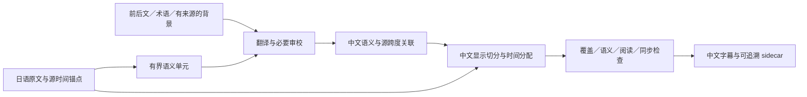

# 字幕翻译调研：上下文、语义映射、恢复与评估

状态：exploratory；源码与公开资料调研，建议未采纳、未运行翻译质量实验  
最后更新：2026-10-05  
范围：用户指定 Subtitle Edit、VideoLingo、pyVideoTrans，并扩展到文档翻译、专用翻译模型与日译简中字幕评估。只读研究相邻项目；不改变 W0／X0、不上传私人音频或字幕。

## 核心判断

推荐的实验方向是：**保留源文时间锚点，按语义组织翻译，允许一个有界源文跨度产生多个中文字幕，再验证意义和显示时间。** 上下文窗口、实际翻译范围和最终字幕条目是三个不同的单位。



先导出 `jpn.srt` 本身没有问题。问题是把为了阅读而切开的每个 cue，当成必须独立翻译且必须一对一对应的完整句子；另一个问题是导出后只留下 SRT，丢掉更细的源文时间和来源数据。已有 SRT 也能作为输入：保留其时间锚点，再在允许的范围内合并语义单元。没有词级时间时，不应假装能够精确恢复任意新切分。

“整段理解后翻译”合理，但不等于“把整片无锚点地译成一篇中文，再随意分回时间轴”。也不能把该路线称为行业唯一通用做法：AppTek 在 IWSLT 2025 仍采用先建源字幕模板、再保留块与时间进行翻译的路线，并处理长度和阅读速度约束。[AppTek 2025](https://aclanthology.org/2025.iwslt-1.21/)

## 证据入口与边界

本机三个相邻目录均未发现 Git checkout 元数据。各分报告分别记录本地行号、文件摘要或与固定上游文件的核对，不能将一个匹配文件扩展成“整个目录就是该 commit”。公开文档可能对应不同版本，源码观察优先说明所在路径和版本。

| 分报告 | 负责的问题 |
| --- | --- |
| [Subtitle Edit](2026-10-05-translation-subtitleedit.md) | 引擎差异、上下文、结构化返回、恢复策略 |
| [VideoLingo](2026-10-05-translation-videolingo.md) | 语义切分、主题术语、翻译与反思、重新分字幕及时间回填 |
| [pyVideoTrans](2026-10-05-translation-pyvideotrans.md) | 文本／SRT 批处理、完整上下文、重试与容错 |
| [主流方法与模型契约](2026-10-05-translation-methods.md) | 文档上下文、记忆、专用模型输入契约和结构化输出 |
| [质量评估](2026-10-05-translation-evaluation.md) | MQM、自动指标、盲评、端到端错误归因 |

以下架构与恢复流程是本次综合建议，不冒充这些项目已有的共同实现。

## 三个项目实际怎么做

| 项目／路径 | 实际机制 | 值得借鉴 | 不能误读的限制 |
| --- | --- | --- | --- |
| Subtitle Edit 的本地 advanced 路径 | 默认每批 10 条，前 12 对已译原文／译文；可填 synopsis、glossary、风格；编号 JSON 与 schema；异常重试后折半 | 静态提示放前面以利 prefix cache；历史例句一致性；结构与复制检测 | 仍要求每条对应；历史不是自动剧情摘要；普通本地路径与 advanced 提示不同；单条残留复制／空结果有放行或原文回填边界 |
| VideoLingo | 先分语义、提取主题术语；约 600 字符／最多 10 行一批，前 3 行和后 2 行原文作上下文；初译后可反思意译；后续拆字幕、关联源词时间 | 语义翻译与显示切分分开；显式前后文；命中术语注入 | 默认摘要只读开头 8,000 字符；并发批次不共享滚动译文记忆；反思不是独立模型裁判；后处理及缓存存在需防范的静态风险 |
| pyVideoTrans | 通用渠道发送换行文本或完整 SRT 批次；可注入完整源字幕上下文；专用渠道另有输入适配 | provider 差异明确；可以复用源时间轴；专用 MT 不强套通用格式 | 主要路径无 JSON schema、未见自动折半；文本缺行填空、多行截取；SRT 等数不能证明语义或原 ID 对应 |

表中是审计文件内的默认／路径，不是三个应用所有配置的统一行为。完整文件、版本、行号与摘要在上方三份源码分报告。

最值得强调的是 Subtitle Edit 的实现已经把用户提到的两种方案**同时使用**：schema 约束 JSON，加失败后的缩批。因此“用了 JSON 就不再需要恢复”不符合实际工程情况。其 advanced 单条路径为了减少专用翻译模型复制历史，会撤去历史；这是有明确故障背景的折中，却可能牺牲短句消歧。不要不加区分地复制到 Kototoki。[固定参考源码](https://github.com/SubtitleEdit/subtitleedit/blob/3a391f06d5994422013210e78585eb87947f704a/src/ui/Features/Translate/LlamaCppAdvanced/AdvancedTranslatorBase.cs)

VideoLingo 的核心启发是**语义切分在前、显示切分在后**，但它也保留分段 ID／对应与格式校验，并非任由整片译文随意改写。其翻译块的返回还会按原文字串相似度重新匹配；重复原文块可能使不同上下文的结果混淆，这是静态代码风险，不是本轮已经复现的质量故障。[固定参考源码](https://github.com/Huanshere/VideoLingo/blob/01f843492759be9bbfd1a5cb697b799cc9de1609/core/_4_2_translate.py)

三个项目的复杂流程证明它们在处理真实问题，不证明任何一路在用户的日语影片上质量最优。尤其不能把 schema 完整、任务没抛异常或“Netflix 级”介绍，当作语义验收证据。

## 上下文如何组织

建议分四层，而非不断往聊天历史里追加所有内容：

1. **稳定背景**：视频标题、可信简介、语言与字幕风格。背景用于消歧，不用于补写没说过的剧情；标题党、营销简介和模型世界知识不能覆盖当前台词。
2. **术语与人物表**：姓名、别名、称呼、组织、固定译名，保留来源和不确定性；不能因角色姓名尚未揭示，就提前替换含糊称呼。
3. **局部原文上下文**：当前块前后的完整话轮，当前待翻译跨度明确标记。离线翻译可以看后文，不必只携带过去；但不能把后文信息提前写进当前字幕。
4. **有来源的场景记忆**：此前已明确的事件、指代关系、未决问题与已确认译名。优先从原文提炼，保留源 ID；已接受译文用于表达一致性，不能成为唯一事实来源。

“前文译文 compact 后传给下一批”值得试，但存在错误自我强化：译错一次，摘要把错误固化，后续又把摘要当事实。建议场景级摘要可以由原文重建，场景边界重置短期状态；摘要更新与翻译结果分别版本化。全片知识也要区分“观众此时已知”和“后文才揭示”。

术语检索宜只带本块相关项，避免几千条词典占满上下文。纯原文预分析可并行产生章节背景；如果采用依赖前批译文的滚动状态，就要承认顺序依赖和吞吐成本，不能同时把全部批次并发后声称它们使用了最新记忆。

注意 API 的实际契约：DeepL 的 `text[]` 各元素独立翻译，放进同一 HTTP 请求不代表共享语境；其 `context` 才是额外且不被翻译的上下文。不能从“批量 API”推断“联合翻译”。[DeepL Translate API](https://developers.deepl.com/api-reference/translate/request-translation)

## 如何保留自由表达，同时防止偏移

需要分别检查四种偏移：源 ASR 的时间就错了；译文挂到错误源句；一个译文内部的信息出现过早／过晚；长片累计遗漏、重复或跨场景串接。单独检查返回条数只能覆盖其中很小一部分。

建议保留三层数据：

- **源时间层**：不可变的原文、unit ID、源字符范围、原始起止时间及可信度。沿用现有 [display sidecar](../testing/demo-display-contract.md) 保留来源的原则；它不是已经实现的翻译接口。
- **翻译层**：有界语义单元的中文含义及其源跨度。允许多个源 cue 合成一个翻译单元；单元内可以调整语序、合拆句子。
- **显示层**：把译文按中文句法、阅读速度、停顿和说话人边界切为 cue；每个 cue 仍能追溯到翻译单元和源跨度。

同一语义单元内的语序变化不要求逐字单调对应；跨场景、跨长静音或明显换人不能无约束重排。JSON 里的 `source_ids` 只是模型提出的关联，还需要覆盖检查与语义复核，不能当成事实证明。

合成示例：日文连续说「このことを知っているのは」「君だけだ」，可以共同译为「只有你知道这件事」。两个原 cue 不需要生硬变成两个独立中文句子。但若中间有长时间停顿或镜头悬念，提前把「你」显示出来会破坏信息出现的时机；应保留展开顺序或重新设计显示切分。

时间分配应从**源文与日语音频的对齐**得到，再通过双语语义关联传播到中文。普通单语 forced aligner 不能把中文译文强行对齐到日语音频；中文字数按比例分时也只是启发式，不能当作声学真值。找不到可靠细粒度对应时，保留整个可信跨度、扩大复核范围或标记低置信度，比制造精确毫秒更诚实。

最小结构可类似下列合成记录。目标字幕条数可以与源 cue 不同；真正的覆盖不变量在源跨度和语义单元层：

```json
{
  "unit_id": "u17",
  "source_ids": ["s41", "s42"],
  "translation": "只有你知道这件事。"
}
```

时间由程序从源锚点派生，不让翻译模型重新编写整份时间码。进一步拆成多个目标 cue 时，单独保存其与单元内源跨度的关联；不把这个最小示例误当成完整对齐协议。

## JSON 与失败恢复

需要区分三层：提示词要求 JSON；服务端 JSON 模式保证合法 JSON；schema／grammar 约束解码限制允许结构。服务的支持范围、截断、拒答和字段约束仍需核对。正确 JSON 仍可能包含错误 ID、漏译、错译或整段日文原样返回。

建议输入输出使用稳定 ID，应用层验证：ID 唯一且属于本次允许范围、必要源跨度完整记账、无非预期重复、非空文本、目标语言疑点、截断／拒答／异常状态。若允许合拆，就检查合法 source-span 覆盖和最终内容归属，而非要求译文字幕条数等于原文条数。结构校验是确定性的；语义遗漏是否真实发生，需要额外判断。

“50 行失败，改 25 行”仍有意义：它能缩小输出长度、降低遵守约束的难度，也便于定位坏片段。但是不应对所有错误使用同一种退避，更不应偷偷补原文后记作成功。

| 失败 | 建议处理 |
| --- | --- |
| 超时、429、服务暂时错误 | 有上限的等待与重试；减少行数不能直接解决认证或限流问题 |
| 输入／输出 token 超限、截断 | 保留上下文，减少实际待翻译单元；优先在语义边界拆批 |
| 非法结构、缺 ID、重复 ID | 对无歧义的编码问题作机械处理；否则限定失败单元重新请求，不靠猜测搬运译文 |
| 输出日文、复制输入、拒答、解释性废话 | 核查源／目标语言和模型模板，简化冲突约束；有界重试或切换已验证路径，最终显式失败 |
| 有效中文但疑似错意、跨单元漏译 | 连同相关相邻单元重新审校；不要只修一行而破坏跨句依赖 |

拆批应缩小待翻译范围，同时保留只读邻近上下文。仅把 50 行砍成两个互不相见的 25 行可能损失之前依赖的上下文。保留已验证单元时要按最小语义依赖组处理；如果整个块自由译写且映射已经损坏，不能机械拼接局部“成功”。

“JSON 会略微降低质量”不是可普遍套用的结论。模型训练与模板适配、schema 复杂度、输出 token 成本都可能影响结果，应比较同一模型、同一语料下的净质量与有效成功率。不支持结构化指令的专用模型，可以翻译一个有程序 ID 的语义单元，返回纯文本，由外层封装 JSON；无需要求每个模型都兼任协议生成器。

缓存键也不能只含原文：至少需要目标语言、模型／权重身份、提示词版本、采样参数及相关上下文／术语版本。否则改了译名后仍可能取到旧译文。失败重试要保留真实状态、次数和使用过的回退模型，防止隐藏成本与污染评测。

## 日文输入、日文输出如何发现

建议组合输入输出相似度、假名比例、窗口级语言识别、正常专名白名单和语义覆盖疑点，不用单条启发式直接判死刑。中日文共享大量汉字；「東京」「先生」和人名不变不必然是失败。反过来，完全没有假名也不能证明已译成正确中文。

较长日语句子逐字复制、有大量未解释假名、输出混入分析文字是强告警；短句与专名应交给上下文判断。记录“原样合理保留”和“疑似未翻译”两个状态，避免为了降低未翻译率而强迫模型改写姓名。

可能原因包括语言配置错误、模板不符合专用模型、上下文或输出截断、复制倾向、服务端缓存／解析映射错误，或者拒答；这些是排查分支，并非本轮已经确诊的某个用户案例。参数如 temperature 调低或 repetition penalty 调高不能替代诊断。

## 专用翻译模型不能一概而论

| 路线 | 本轮核实的输入边界 | 对本项目的意义 |
| --- | --- | --- |
| HY-MT2 | 官方有基本翻译、术语、背景、风格和结构化数据示例；基本使用不要求 system prompt | 可以探索上下文增强，但先按官方模板建基准；不要把 generic chat 提示的失败等同模型能力不足 |
| TranslateGemma | 官方模板的消息内容包含源／目标语言代码和文本，限定角色与单条内容；替代模板不在官方支持范围；模型卡写 2K 输入上下文 | 不能从其基础模型窗口推导它适合整片长提示；也不能强套任意多轮 history／system JSON 协议 |
| Qwen-MT | 所核实产品是云端 API；单 user 消息，术语、记忆、领域通过专用选项传递，不支持多轮或 system 消息 | 它与可下载的通用 Qwen 权重不同；不能因名字相近宣称本地可运行此 API 产品 |
| NLLB | 以语言 token 控制的 seq2seq；官方卡强调句子级研究使用、不面向文档，训练输入未超过 512 token，权重为非商用许可 | 适合作为受限的传统 MT 对照思路，不能直接套聊天提示或默认为可商用产品基础 |

来源：[HY-MT2 官方仓库](https://github.com/Tencent-Hunyuan/Hy-MT2)、[TranslateGemma 模型卡](https://huggingface.co/google/translategemma-4b-it)、[Qwen-MT 官方文档](https://www.alibabacloud.com/help/en/model-studio/machine-translation)、[NLLB 模型卡](https://huggingface.co/facebook/nllb-200-distilled-600M)。更完整版本、模型大小、日中方向证据与许可证边界见[模型契约分报告](2026-10-05-translation-methods.md)。本轮不声称某模型在 RTX 5080 上已通过显存／速度测试，也不将供应商成绩转成日译中字幕排名。

## 字幕特有的技巧与取舍

最有价值的技巧通常是：重组被显示切碎的语义、明确只翻译的范围、术语一致、只读前后文、可验证来源和只修异常片段。进一步可在文本歧义时使用画面 OCR、说话人或音视频片段辅助，但要测其边际收益，不能根据画面猜补没说过的话。

译后反思／编辑值得作为独立实验，尤其检查否定、数字、指代、专名与语气；不能默认多轮润色一定提升忠实度。保存初稿及修改理由，避免把简洁但正确的台词“润色”为更完整却虚构的解释。

压缩字幕是独立操作：先保证含义完整，再在显示超限时有选择地压缩，并复查关键事实。Netflix 简中规范给出每行 16 字、最多两行、成人每秒至多 9 字等约束，可作外部参考配置，但不自动成为用户要求；其歌曲、重复语句等内容策略也不能直接覆盖 Kototoki 的保留偏好。[Netflix 简中规范](https://partnerhelp.netflixstudios.com/hc/en-us/articles/215986007-Chinese-Simplified-Timed-Text-Style-Guide)

完整内容版本与用于显示的压缩版本应可区分；不能为了字符限制隐藏未经记录的信息删除。阅读速度合规、时间不重叠和翻译忠实是分别报告的指标。

## 建议的验证顺序

先选一条通用指令模型路线和一条遵守官方模板的专用翻译路线；本轮不给未实测模型排质量名次。模型身份、量化、runtime、完整提示词、token 预算和解码参数固定后，再分阶段比较流程，避免把模型差异与上下文策略混在一起。

| 阶段 | 对照 | 要回答的问题 |
| --- | --- | --- |
| 输入隔离 | 人工核对原文；相同片段的 W0／X0 原始输出 | 译错来自 ASR 还是翻译？ |
| 语义单位 | 原 cue 独立；有前后文但固定 cue；可合拆的有界语义单元 | 自由重排收益是否大于重新对齐成本？ |
| 上下文增量 | 局部前后文；再加标题／术语；再加源文场景摘要 | 哪种信息实际解决歧义，哪种造成误导？ |
| 输出协议 | 原生纯文本包装；轻量 ID JSON；受支持的 schema | 实际成功率、忠实度、重试和成本分别怎样？ |
| 审校 | 无审校；仅异常片段；全量第二遍 | 是否减少严重错误，是否引入过度改写？ |
| 显示 | 相同语义译文的不同切分与计时 | 改进来自翻译，还是仅来自可读性？ |

小样本先用于发现失败模式，再锁定配置做独立场景保留验证；场景数量、影片覆盖和统计不确定性需报告，不把来自同一段剧情的几十条字幕当成几十个独立样本。评审先看日文、足够上下文和匿名译文，逐处标错，再做成对偏好；另看中文自然度与真实播放体验。[详细评估建议](2026-10-05-translation-evaluation.md)

强模型可以充当主要语义审校员，但不能预设某个模型（包括 Astra）必然最准，也不能让候选模型只给自己的译文打分。采用盲评、交换候选顺序、平局选项、证据片段和独立复核；重要歧义最终回到原声／画面与有能力的人工判断。

优先报告严重错意、遗漏／幻觉、称谓一致性、目标语言异常和人工修订工作量，再报告自动分数与每分钟处理成本。COMET 类指标、字符相似度、回译、SubER 都不能单独代表“日语剧情理解正确”。[SubER 论文](https://aclanthology.org/2022.iwslt-1.1/)与 [A-TASC／SacreSubER](https://aclanthology.org/2025.acl-long.157/)提供字幕评估参考；实际工具版本和中文分词方式必须固定，当前 [SubER](https://github.com/apptek/SubER) 已声明支持中日韩语言选项。

## 本轮完成范围

本轮完成源码与一手资料调研、方法综合及后续实验建议；没有运行翻译模型、证明 RTX 5080 的翻译吞吐／显存、建立模型排名或验证字幕质量提升。已检查 README、AGENTS 与相关显示契约：现有转录基线说明继续成立，无需将探索性翻译方案写成已实现能力。新增研究通过 docs/INDEX.md 路由。
