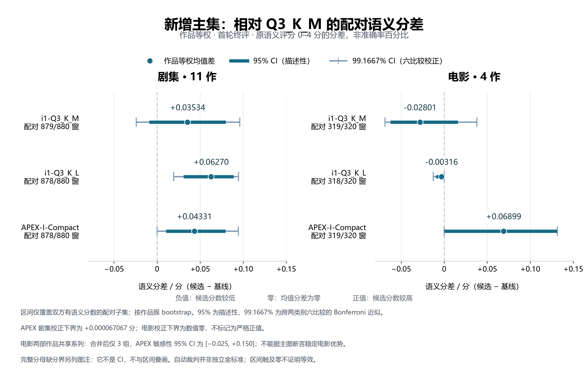
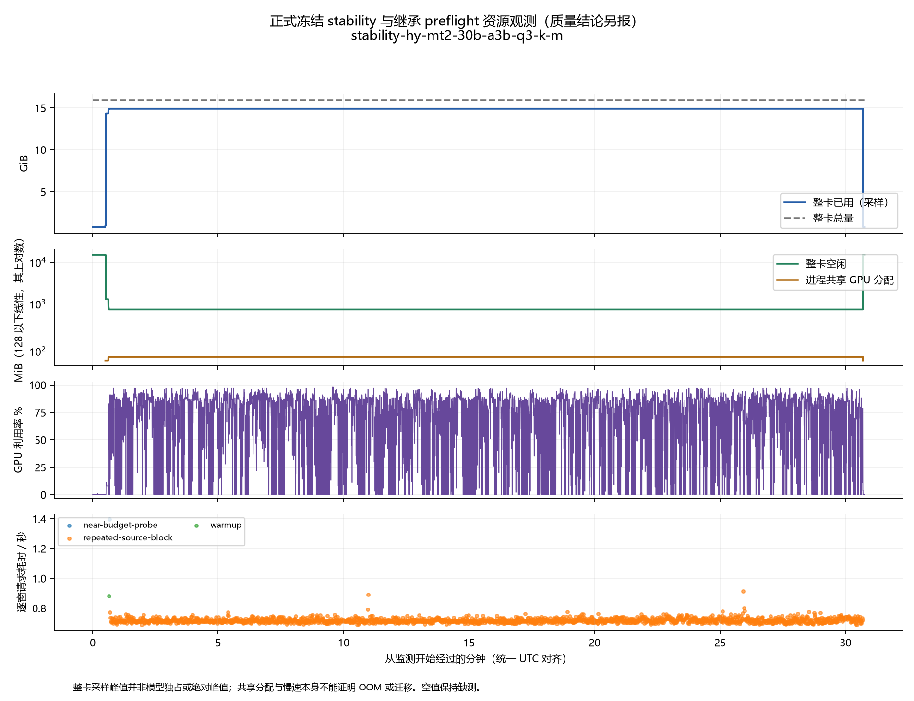
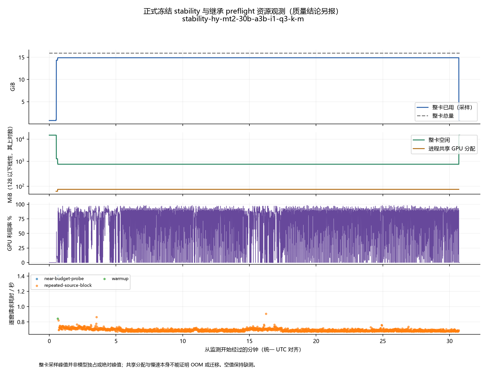
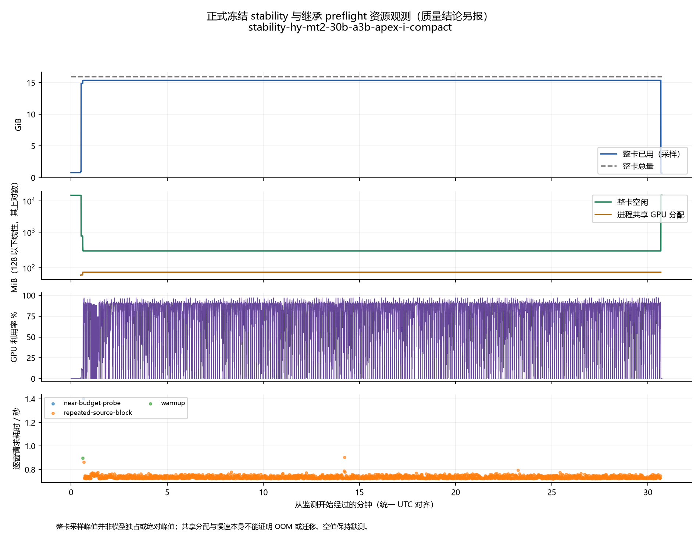
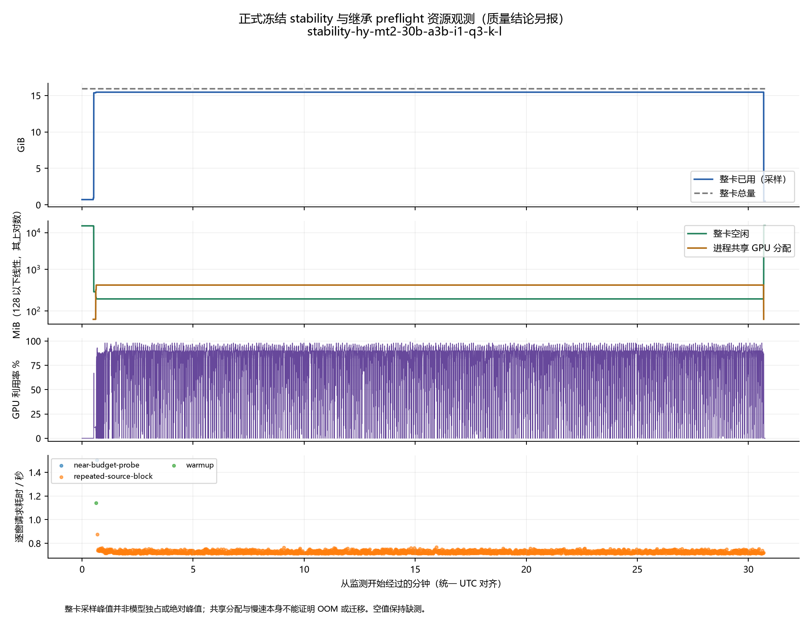

# Hy-MT2 30B-A3B 四种量化：质量、交付与本机运行成本

本轮已完成新增 1,200 窗／6,000 IDs 的参考建设与四候选首轮终评、旧 83 窗回归，以及四轮正式性能。APEX-I-Compact 在新增剧集有小幅正向自动评分信号，电影在校正与系列敏感性后尚未稳定区分；i1-Q3_K_L 的剧集信号更强，但耗时状态变化、极小显存余量和最高严重度错误限制其默认使用。i1-Q3_K_M 没有稳定全面收益。当前证据不支持无条件替换基线，可将 APEX-I-Compact 作为质量优先的有条件候选。

基线在四轮均于同一新增窗口交付失败，这是应明确保留的实际缺陷。三个新候选各有四个完整成功会话，但本轮所有相对基线的有效加速倍率、秒差、百分比均为 NA，失败会话成本单独报告。四款正式长跑的 runner 已实际 exit 0；完整独立审计、释放与复现证据已纳入下文，基线是否替换仍由用户决定。

## 比较范围与固定方法

| 报告名称 | 匿名 ID | 精确候选身份 |
| --- | --- | --- |
| i1-Q3_K_M | c01 | hy-mt2-30b-a3b-i1-q3-k-m |
| i1-Q3_K_L | c02 | hy-mt2-30b-a3b-i1-q3-k-l |
| APEX-I-Compact | c03 | hy-mt2-30b-a3b-apex-i-compact |
| Q3_K_M 基线 | c04 | hy-mt2-30b-a3b-q3-k-m |

平台为原生 Windows 11／RTX 5080，驱动观测 617.14，CPU 为 Ryzen 7 5800X3D。四份 GGUF 及兼容 llama.cpp b11429 引擎、补丁和 33 个 DLL 均以冻结身份对应，完整权重身份来自本轮冻结资产核验。身份、来源 revision 与完整 SHA256 见精确身份附录。

| 分轨 | 每候选规模 | 用途 |
| --- | --- | --- |
| 新增主集 | 15 作品各 80 窗，共 1,200／6,000 IDs | 本轮主比较；剧集 880 窗、电影 320 窗 |
| 旧 test | 83 窗／414 IDs | 已参与历史选型的 test-informed 回归，本轮新推理与新评分，单独解释 |
| dev / smoke | dev 41／204，smoke 15／75 是其子集 | 流程验证，不进入正式质量 |
| 正式性能 | 各四轮，每轮旧 83＋新 1,200 | 完整集墙钟与资源；重复译文不增加质量样本 |
| 固定窗口长跑 | 每候选至少 1,800 秒 | 稳定性与慢尾；重复请求不增加质量样本 |

翻译只接收相同冻结日文 context 与计分 IDs，不接收中文参考或判分。通常七个上下文单元、中间五个计分，旧集实际 IDs 数以清单为准。配方固定 temperature 0、seed 20261006、context 4096、输出上限 1024、batch 256／ubatch 128、单槽、flash attention on、fit off、GPU layers 请求 99、线程 8、KV f16、Hy30 no_think、JSON/GBNF、cache_prompt:false；最多两次相同请求，不改失败窗预算。质量只采用第一轮最早持久化终态，后轮成功不能挽救首轮失败。

评分使用 sol-high-auto-v1：全量机械检查、每窗 fresh 主评、按作品固定 20% 抽样与跨四候选风险并集的 fresh 盲复评，必要时一次有界裁决。主评与复评隐藏既有评分，裁决可看匿名意见，不能称为盲复评。全部请求 gpt-6.1-sol/high，但实际 returned model／effort 未暴露，不能把请求配置说成已验证返回身份。参考与裁判同家族、fresh 调用不构成独立金标准；未做人工或音画审定。

语义 0–4 先按窗口汇总到作品，再在剧集／电影内对作品等权；自然度 0–2 单列。语义 null 保留预期分母，以 0／4 给上下界，程序交付零另外计数。上下界不是 CI。配对 bootstrap 10,000 次、seed 20261006、类别内作品簇：95% 描述区间，98.333333…% 为每类别三个预定对照校正，99.166666…% 为六个跨类别对照校正。区间只覆盖完整可评分配对子集，完整分母界仍须同时解释；字幕行与同窗候选对不当独立样本。

## 参考建设与抽样边界

新增集在查看四候选输出前，以 seed 20261006 固定机械抽样和候补顺序。先用随机起点切互不重叠七单元块；剧集排除旧 dev/test 整集，按季与集序八层各随机一集、每集十窗；电影按配对白位置十层各八窗。条件纳入概率只针对这一机械块框，不含切块随机起点的概率；复核筛选改变适用场景，留存样本不冒充未经筛选的概率样本。

历史审核 1,428 个不同源窗：主审 1,428、fresh 复审 1,428、必要裁决 331，共 3,187 次调用，无重试。移除 228 窗，同层五轮补位 186／32／8／1／1；最终 1,200＝1,014 个初始留存＋186 个补位留存，934 窗双审一致、266 窗裁决定稿。曾补入再移除的 42 窗只记历史成本。逐作品与逐层拒收率及概率口径在方法附录。

全部最终 context 源事件彼此不重叠，并与旧 dev/test 及隔离范围分离：8,400 个 context 单元、16,800 个语言源事件键、16,240 个去语言原始事件键是三种单位，不等于计分字幕条数。原 v2 库保持只读，天气之子仍隔离；最终完整性匹配 2,479/2,479 文件。快照相同不证明观察间从未短暂变化，也不覆盖库外上游原件。源侧术语目录在正式候选输出前准备，其实际文件与正式冻结快照一致；没有将目录或中文参考喂给翻译器。

## 新增主集：首轮最终质量

### 完整分母与终态

| 候选 | 终态分类 | 接受语义终分 | 语义缺分 | 程序交付零 | 漏计分 IDs | 复评窗 |
| --- | --- | --- | --- | --- | --- | --- |
| i1-Q3_K_M | reference_suspect=15；scored=1142；source_ambiguous=43 | 1199/1200 | 1 | 0 | 0 | 792 |
| i1-Q3_K_L | reference_suspect=14；scored=1146；source_ambiguous=38；unresolved=2 | 1197/1200 | 3 | 0 | 0 | 792 |
| APEX-I-Compact | reference_suspect=16；scored=1145；source_ambiguous=38；unresolved=1 | 1198/1200 | 2 | 0 | 0 | 792 |
| Q3_K_M 基线 | delivery_zero=1；reference_suspect=14；scored=1155；source_ambiguous=29；unresolved=1 | 1198/1200 | 2 | 1 | 5 | 792 |

终态分类不等于接受语义分的数量：reference_suspect、source_ambiguous 中存在被冻结流程接受的非 null 终分时，也纳入已知分母；保留 null 的记录进入缺分界。接受终分不证明参考／源问题已经消失。四候选共同有语义终分为 **1195/1,200** 窗；所有配对区间只描述相应完整配对子集。

### 类别质量

| 候选 | 范围 | 预期窗 | 计分 IDs | 接受语义/预期 | 语义缺分 | 程序交付零 | 完整分母语义界 | 自然度 | 自然度覆盖 |
| --- | --- | --- | --- | --- | --- | --- | --- | --- | --- |
| i1-Q3_K_M | 动画剧集 | 880 | 4400 | 880/880 | 0 | 0 | [3.1761, 3.1761] | 1.9057 | 880/880 |
| i1-Q3_K_M | 动画电影 | 320 | 1600 | 319/320 | 1 | 0 | [3.2594, 3.2719] | 1.9250 | 320/320 |
| i1-Q3_K_L | 动画剧集 | 880 | 4400 | 879/880 | 1 | 0 | [3.1989, 3.2034] | 1.8909 | 879/880 |
| i1-Q3_K_L | 动画电影 | 320 | 1600 | 318/320 | 2 | 0 | [3.2781, 3.3031] | 1.9248 | 319/320 |
| APEX-I-Compact | 动画剧集 | 880 | 4400 | 879/880 | 1 | 0 | [3.1818, 3.1864] | 1.8965 | 879/880 |
| APEX-I-Compact | 动画电影 | 320 | 1600 | 319/320 | 1 | 0 | [3.3563, 3.3687] | 1.9000 | 320/320 |
| Q3_K_M 基线 | 动画剧集 | 880 | 4400 | 879/880 | 1 | 1 | [3.1375, 3.1420] | 1.8872 | 877/880 |
| Q3_K_M 基线 | 动画电影 | 320 | 1600 | 319/320 | 1 | 0 | [3.2875, 3.3000] | 1.9062 | 320/320 |

### 三个预先指定的对基线配对比较

| 类别 | 候选−基线 | 配对窗/预期 | 配对作品/预期 | 胜/平/负 | 作品等权语义差 | 95% CI | 98.33% CI | 99.1667% CI | 完整分母差界 |
| --- | --- | --- | --- | --- | --- | --- | --- | --- | --- |
| 动画剧集 | i1-Q3_K_M | 879/880 | 11/11 | 130/639/110 | 0.0353 | [-0.0091, 0.0797] | [-0.0182, 0.0899] | [-0.0242, 0.0961] | [0.0341, 0.0386] |
| 动画剧集 | i1-Q3_K_L | 878/880 | 11/11 | 139/636/103 | 0.0627 | [0.0307, 0.0888] | [0.0229, 0.0932] | [0.0193, 0.0945] | [0.0568, 0.0659] |
| 动画剧集 | APEX-I-Compact | 878/880 | 11/11 | 146/615/117 | 0.0433 | [0.0104, 0.0796] | [0.0035, 0.0888] | [0.0001, 0.0944] | [0.0398, 0.0489] |
| 动画电影 | i1-Q3_K_M | 319/320 | 4/4 | 34/247/38 | -0.0280 | [-0.0625, 0.0160] | [-0.0688, 0.0222] | [-0.0688, 0.0380] | [-0.0406, -0.0156] |
| 动画电影 | i1-Q3_K_L | 318/320 | 4/4 | 26/261/31 | -0.0032 | [-0.0095, 0.0000] | [-0.0095, 0.0000] | [-0.0127, 0.0000] | [-0.0219, 0.0156] |
| 动画电影 | APEX-I-Compact | 319/320 | 4/4 | 44/246/29 | 0.0690 | [0.0002, 0.1313] | [约 0, 0.1315] | [约 0, 0.1315] | [0.0563, 0.0812] |

bootstrap 10,000 次、seed 20261006，以作品为簇在类别内保持配对。表头 98.33% 的实际置信水平为 98.333333…%，用于各类别三个预先指定对照；99.1667% 的实际水平为 99.166666…%，用于跨两类别六个对照的 Bonferroni 近似。作品数量少、共享系列及同模型裁判偏差限制覆盖保证。缺分界优先约束完整范围；未显著区分不证明等效。逐作品胜平负、移除每个作品和共享系列敏感性见完整表。

### 严重错误、未知范围与复评波动

| 类别 | 候选 | 终评 minor/major/critical 条 | 严重影响窗/已知 | 已知窗口率 | 完整预期窗口率界 | 共同四候选窗严重影响/已知率 | 主评指控 major/critical 条 |
| --- | --- | --- | --- | --- | --- | --- | --- |
| 动画剧集 | i1-Q3_K_M | 360/306/0 | 269/880 | 30.57% | [30.57%, 30.57%] | 269/877；30.67% | 323/0 |
| 动画剧集 | i1-Q3_K_L | 360/285/2 | 257/879 | 29.24% | [29.20%, 29.32%] | 257/877；29.30% | 301/2 |
| 动画剧集 | APEX-I-Compact | 328/306/0 | 278/879 | 31.63% | [31.59%, 31.70%] | 278/877；31.70% | 317/0 |
| 动画剧集 | Q3_K_M 基线 | 363/320/1 | 284/879 | 32.31% | [32.27%, 32.39%] | 283/877；32.27% | 328/1 |
| 动画电影 | i1-Q3_K_M | 102/99/0 | 90/319 | 28.21% | [28.12%, 28.44%] | 90/318；28.30% | 103/0 |
| 动画电影 | i1-Q3_K_L | 92/93/0 | 83/318 | 26.10% | [25.94%, 26.56%] | 83/318；26.10% | 91/0 |
| 动画电影 | APEX-I-Compact | 106/84/0 | 76/319 | 23.82% | [23.75%, 24.06%] | 76/318；23.90% | 87/0 |
| 动画电影 | Q3_K_M 基线 | 99/96/0 | 87/319 | 27.27% | [27.19%, 27.50%] | 86/318；27.04% | 101/0 |

major/critical 指冻结终评支持的实质／中心意义错误；条数与涉及窗口数分开，复评前指控不等于终评支持。语义 null 不进入已知支持错误分母，完整预期范围仍保留未知上下界。严重影响窗口率按窗口计，不作作品等权；delivery_zero 另列为交付失败及程序语义零，不把空错误清单解释成译文无错。

| 类别 | 候选 | 主评/预期 | 已复评窗 | 主复评分歧/可比 | 任一评分字段变化（含 null） | 语义 null 转换窗 | 主终语义可比窗 | 主终平均绝对语义改分 | 主终作品等权语义变化 |
| --- | --- | --- | --- | --- | --- | --- | --- | --- | --- |
| 动画剧集 | i1-Q3_K_M | 880/880 | 597 | 154/597 | 42 | 0 | 880 | 0.0489 | 0.0239 |
| 动画剧集 | i1-Q3_K_L | 880/880 | 597 | 153/597 | 59 | 1 | 878 | 0.0558 | 0.0147 |
| 动画剧集 | APEX-I-Compact | 880/880 | 597 | 149/597 | 43 | 0 | 879 | 0.0398 | 0.0148 |
| 动画剧集 | Q3_K_M 基线 | 879/880 | 597 | 174/597 | 52 | 0 | 878 | 0.0467 | 0.0012 |
| 动画电影 | i1-Q3_K_M | 320/320 | 195 | 44/195 | 9 | 0 | 319 | 0.0251 | 0.0063 |
| 动画电影 | i1-Q3_K_L | 320/320 | 195 | 53/195 | 20 | 2 | 317 | 0.0568 | -0.0189 |
| 动画电影 | APEX-I-Compact | 320/320 | 195 | 51/195 | 17 | 0 | 319 | 0.0439 | 0.0125 |
| 动画电影 | Q3_K_M 基线 | 320/320 | 195 | 46/195 | 13 | 0 | 319 | 0.0345 | 0.0219 |

主评、fresh 独立复评均按 Sol 模型家族配置请求，选中子集由事前随机／风险并集规则产生；不是随机抽取总体误差样本。请求配置与可核验返回身份分开记于全流程执行账目，不能以请求模型名替代实际返回身份证据。终评可能继承主评、采用一致复评或裁决，不能一律视为独立盲评或金标准。平均绝对变化和净变化口径不同；评分变化不等于译文变化。

### 完全相同译文的条件化裁判差异

完整相等性比较预期 7,200 个窗口候选对。观察到相同输出 **169 窗、176 组、273 对**；相等性未知 3 对。比较只忽略 map 键顺序，ID、全部字符、空格和 Unicode 均保留，不以归一化合并不同译文。

| 评分阶段 | 有语义差值/相同对 | 缺分对 | 非零差对 | 有符号均差 | 绝对均差 | 严重分类分歧对 | 严重指控范围分歧对 | 有符号差值分布 |
| --- | --- | --- | --- | --- | --- | --- | --- | --- |
| 独立主评 | 273/273 | 0 | 10 | 0.0110 | 0.0549 | 6 | 11 | {"-1": 2, "-2": 2, "0": 263, "1": 3, "2": 3} |
| 独立复评（选中范围） | 142/273 | 131 | 10 | 0.0141 | 0.0845 | 6 | 13 | {"-1": 3, "-2": 1, "0": 132, "1": 5, "2": 1} |
| 终评（含继承/裁决） | 272/273 | 1 | 11 | 0.0147 | 0.0588 | 8 | 14 | {"-1": 2, "-2": 2, "0": 261, "1": 4, "2": 3} |

此诊断条件化在同窗、文本完全相同的候选组，多个候选对互相关联，不能当独立样本作显著性检验，亦不能推广为总体裁判误差界。各匿名候选仍独立主评，没有复制评分；复评与裁决来源另计。同一模型家族的偏差不会因请求独立而消失，译文相同或评分一致都不证明译文／参考正确。终评来源与缺分侧数见完整表。

### 源侧封闭术语目录的字面诊断

在查看正式候选译文之前，以原日文与既有参考词典构建有限目录；声明 30 个词，源侧至少两窗口门槛纳入 29 个。匹配尊重预先声明的上下文与可接受别名族，未对候选输出追加词或调用新的语义裁判。

| 候选 | 符合门槛的源侧出现数 | 单族命中 | 未分类 | 多族歧义 | 缺译文 | 潜在不一致组 |
| --- | --- | --- | --- | --- | --- | --- |
| i1-Q3_K_M | 383 | 309 | 74 | 0 | 0 | 0 |
| i1-Q3_K_L | 383 | 320 | 63 | 0 | 0 | 0 |
| APEX-I-Compact | 383 | 304 | 79 | 0 | 0 | 1 |
| Q3_K_M 基线 | 383 | 299 | 84 | 0 | 0 | 0 |

“未分类”仅表示没有命中目录中已声明的目标别名，不自动判为未翻译、术语错误或不自然；陌生专名、音译、假名保留和合法别译均可能在目录外。多族与跨窗潜在不一致只是待解释的字面信号，semantic_error 保持 null。封闭目录不穷尽全语料术语，不保证指代一致或语义正确，不能用于自动质量加减分。

作品、集数、位置、长度、风险标签、缺分及敏感性的完整表见 [新增质量附录](<2026-10-07-hy30-four-quantization-results-appendices/expanded-quality-appendix.md>)。模型采纳需结合质量不确定性、正式稳定性、全部性能与维护边界，综合取舍见后文；不据单一分数决定采纳。

图：新增主集相对 Q3_K_M 的配对语义分差。点为候选减基线的作品等权平均差；原评分为 0–4 分，图中单位为“分差”，不是准确率百分比。粗线为描述性 95% CI，细线及端帽为跨两类别六项比较 Bonferroni 近似的 99.1667% CI。区间直接读取封存的首轮统计摘要，未重新 bootstrap，且仅覆盖两侧有语义分数的完整配对子集。每行列出配对窗口覆盖；剧集 11 作，电影 4 作。

APEX 剧集 99.1667% 下界精确为 +0.00006706703107019291 分，仅略高于零；电影对应下界为浮点值 −1.734723475976807e−18，按数值零解释。电影两部作品共享系列，合并后仅 3 组；APEX 此敏感性分析的 95%／99.1667% CI 均为 [−0.025, +0.150]，不支持从主图宣称稳定电影优势。图中没有胜者、显著性星号或等效结论；自动裁判并非独立金标准。

### 配对差值的实际意义

APEX-I-Compact 剧集的六比较区间仍略高于零，但下界仅 0.000067067 分，远小于均值差；“校正后有正向信号”比“明确、大幅胜出”准确。其逐作移除差值范围为 +0.028892～+0.052642，说明这份样本的正向均值不由单作决定。电影逐作移除范围 +0.041983～+0.100316；不过两部 Sword Art Online 电影合并为一个系列簇后，只剩 3 个独立组，差值 +0.066825，95%、98.33%、99.1667% 区间均为 [-0.025, 0.15]。因此电影收益方向值得关注，但尚未稳定区分总体优势。

i1-Q3_K_L 剧集信号比 APEX-I-Compact 强：六比较下界 +0.019318，逐作移除 +0.057724～+0.075225；电影没有正向优势。i1-Q3_K_M 剧集区间跨零，电影本样本即使所有 null 取极端值仍为负，但电影 CI 跨零。可以说“新主集没有稳定全面收益，电影观察样本偏低”，不能把负样本界写成已证明总体更差或把无显著性写成等效。

旧回归集不能与新增集混池增加显著性。APEX-I-Compact 旧剧集差 -0.024242（62/63 配对）、旧电影 -0.166667（20/20）；其旧电影 95% 及校正区间为 [-0.5, 0]，完整样本差也是 -0.166667。旧集样本小，不证明未来电影普遍退步，但与新增电影方向相反，必须保留。其余候选旧集区间也均触及或跨零。新主集结论只能限于本次抽样、来源、配方与同家族自动裁判。

APEX-I-Compact 电影校正下界的实际浮点值 -1.734723475976807e-18 按数值零解释；不能把它宣称为严格正值或实质负效应。小幅自动评分差不是准确率百分点，不以相同译文诊断的条件均差当通用噪声阈值。

## 旧 83 窗回归：与新主集分别解释

四者本轮首轮旧83窗均结构合法，漏ID、交付零、未运行和翻译重试均0。终评状态为scored305、reference_suspect13、source_ambiguous14；冻结流程接受的语义终分是331/332（305＋13＋13），不是只有305条有分。带疑问但有终分的26条不是provisional评分。APEX-I-Compact的一个源歧义窗口保留语义null，四者共同语义覆盖82/83；自然度均83/83。

语义缺分界以0/4代入完整分母，不是置信区间。类别内作品等权，剧集11作品／63窗、电影4作品／20窗；自然度0–2不能与语义0–4相加。各作品完整表、缺分界和自然度在[旧质量附录](<2026-10-07-hy30-four-quantization-results-appendices/regression-quality-appendix.md>)。

| 候选 | 剧集语义完整分母界 | 电影语义完整分母界 | 自然度：剧集／电影 | 语义有分／83 |
| --- | --- | --- | --- | --- |
| i1-Q3_K_M | [3.4000, 3.4000] | [3.4583, 3.4583] | 1.9515／2.0000 | 83/83 |
| i1-Q3_K_L | [3.4121, 3.4121] | [3.4167, 3.4167] | 1.9455／2.0000 | 83/83 |
| APEX-I-Compact | [3.3212, 3.3818] | [3.2333, 3.2333] | 1.9333／1.9583 | 82/83 |
| Q3_K_M 基线 | [3.3667, 3.3667] | [3.4000, 3.4000] | 1.9485／1.9583 | 83/83 |

终评支持的严重错误以major／critical统计，条数与涉及窗口分开；语义null不作为零错误，完整预期影响率保留未知界。下表窗口率不等于作品等权语义估计量，共同82窗用于对齐严重错误范围。

| 候选 | 终评minor／major／critical | 严重错误窗／已知 | 完整83窗影响率界 | 共同82窗严重错误窗 |
| --- | --- | --- | --- | --- |
| i1-Q3_K_M | 24/23/0 | 20/83 | [24.10%, 24.10%] | 19/82 |
| i1-Q3_K_L | 23/21/0 | 19/83 | [22.89%, 22.89%] | 18/82 |
| APEX-I-Compact | 23/26/0 | 23/82 | [27.71%, 28.92%] | 23/82 |
| Q3_K_M 基线 | 28/23/0 | 21/83 | [25.30%, 25.30%] | 20/82 |

预指定差值为候选−基线，类别内按作品簇保持配对和作品等权，10000次、seed20261006。95%为描述性区间；两档校正的实际confidence为98.333333…%（每类别3比较）、99.166666…%（两类别6比较）。区间只覆盖完整配对子集；缺分界优先。

| 类别 | 候选相对基线 | 完整配对／预期 | 胜／平／负 | 作品等权差 | 95%区间 | 98.3333%区间 | 99.1667%区间 |
| --- | --- | --- | --- | --- | --- | --- | --- |
| 剧集 | i1-Q3_K_M | 63/63 | 8/50/5 | 0.0333 | [-0.1030, 0.1515] | [-0.1394, 0.1727] | [-0.1576, 0.1848] |
| 剧集 | i1-Q3_K_L | 63/63 | 6/52/5 | 0.0455 | [-0.0394, 0.1364] | [-0.0636, 0.1545] | [-0.0697, 0.1667] |
| 剧集 | APEX-I-Compact | 62/63 | 5/53/4 | -0.0242 | [-0.1848, 0.1182] | [-0.2303, 0.1455] | [-0.2485, 0.1606] |
| 电影 | i1-Q3_K_M | 20/20 | 2/16/2 | 0.0583 | [-0.1250, 0.3000] | [-0.1250, 0.3000] | [-0.1250, 0.4000] |
| 电影 | i1-Q3_K_L | 20/20 | 2/17/1 | 0.0167 | [-0.4167, 0.3667] | [-0.5000, 0.3833] | [-0.5000, 0.4000] |
| 电影 | APEX-I-Compact | 20/20 | 1/15/4 | -0.1667 | [-0.5000, 0.0000] | [-0.5000, 0.0000] | [-0.5000, 0.0000] |

六项主95%区间均跨零或触零，没有稳定的优于基线证据，不能据此宣称等效。APEX-I-Compact剧集完整分母差值界为[-0.0455,0.0152]，可跨零；完整子集差不能代替该判断。逐作品移除及共享系列敏感性见质量附录：i1-Q3_K_L电影差从+0.0167变为系列组等权-0.0444；电影仅4作品、SAO两电影合并后3组，推断有限。

统一复审56/83窗，四者各56次。i1-Q3_K_M／i1-Q3_K_L／APEX-I-Compact／基线初始主复分歧为14／4／14／19，终评semantic或naturalness字段变化为3／0／2／5；风险富集范围不是总体随机误判率。精确相同译文共有13窗、14组、27对，独立主判27对同分，复审10对中的2对及终评27对中的2对绝对差2分、严重错误分类不同；终评平均绝对差0.1481。条件化且相关的候选对不能作为通用误差界，也不证明参考正确。

旧回归主判332、复审224、裁决51，共607次调用均首尝试成功。全部请求Sol/high，但returned model／effort均未暴露；可核验请求与fresh执行，不能冒认不可见返回身份。来源为[旧回归完整机器表](D:/AI_Projects/kototoki/.local/translation-evaluation/hy30-four-20261006/report-draft-preparation/regression-quality-fragment-v1/numeric-tables.json)和[独立质量审计](D:/AI_Projects/kototoki/.local/translation-evaluation/hy30-four-20261006/formal-regression-quality-audit-v1/summary.json)。

旧基线任一分数字段变化 5 窗包含一次语义 null→4；若仅看两端有数字的任一字段变化，则为 4 窗。新旧两集的改分定义和对应范围见 [复评指标说明](<2026-10-07-hy30-four-quantization-results-appendices/review-metric-definitions.md>)，不将不同口径累加。

## 四轮正式性能与资源

正式 16 会话覆盖 20,528 个窗口位置，无未执行尾段；每会话另有一窗预热。三款各四会话旧／新集全首次成功；基线各轮旧 83 成功，新 1,199 成功／1 失败，失败窗再试仍失败，全部成本保留。完整集墙钟含 tokenizer、请求、验证、重试与持久化开销，排除冷加载／预热及裁判。冷进程加载不等于操作系统文件缓存冷启动。

### 旧回归集（83 窗／414 IDs）：完整集墙钟（秒）

| 候选 | R1 | R2 | R3 | R4 | 合格中位数 | 合格范围 | 合格轮 | 基线倍率／秒差／% |
| --- | --- | --- | --- | --- | --- | --- | --- | --- |
| i1-Q3_K_M | 56.091 | 56.468 | 57.320 | 57.611 | 56.894 | 56.091–57.611 | 4/4 | NA／NA／NA |
| i1-Q3_K_L | 304.202 | 303.053 | 301.009 | 59.019 | 302.031 | 59.019–304.202 | 4/4 | NA／NA／NA |
| APEX-I-Compact | 59.419 | 59.472 | 59.436 | 60.712 | 59.454 | 59.419–60.712 | 4/4 | NA／NA／NA |
| Q3_K_M 基线† | 55.857 | 55.828 | 55.828 | 57.404 | NA | NA | 0/4 | NA／NA／NA |

### 新增主集（1,200 窗／6,000 IDs）：完整集墙钟（秒）

| 候选 | R1 | R2 | R3 | R4 | 合格中位数 | 合格范围 | 合格轮 | 基线倍率／秒差／% |
| --- | --- | --- | --- | --- | --- | --- | --- | --- |
| i1-Q3_K_M | 944.831 | 943.037 | 958.433 | 962.724 | 951.632 | 943.037–962.724 | 4/4 | NA／NA／NA |
| i1-Q3_K_L | 5,238.679 | 5,238.610 | 5,246.743 | 993.222 | 5,238.644 | 993.222–5,246.743 | 4/4 | NA／NA／NA |
| APEX-I-Compact | 1,004.736 | 1,000.754 | 1,011.115 | 1,017.646 | 1,007.925 | 1,000.754–1,017.646 | 4/4 | NA／NA／NA |
| Q3_K_M 基线† | 950.745 | 948.339 | 949.687 | 968.048 | NA | NA | 0/4 | NA／NA／NA |

† 基线列出的 R1–R4 是**失败会话已实际付出的完整集观测耗时**，不能作为成功交付速度。整个失败会话排除于有效比较，所以其中成功的旧 83 阶段也不另行取得速度资格。失败会话新增集成本中位数 950.216 秒，范围 948.339–968.048 秒；该描述不进入相对速度计算。所有候选的倍率、绝对秒差、百分比及同窗相对基线耗时比均为 NA。

基线失败会话中旧集实际成本中位数 55.843 秒，范围 55.828–57.404 秒；它同样只记成本，不恢复整会话速度资格。R4 的失败窗 `H30-W06_E002-B0028` 两次尝试均 input_tokens=533、生成 1,024 tokens、stop_type=`limit`、truncated=false，没有结构化 OOM；重试耗时 5.127797 秒仍计入新集成本。这些技术终态不构成翻译语义评判。

完整集墙钟从首个正式窗口开始至该集最后终态产物持久化，包含 tokenization、请求、验证、重试和运行器开销；排除冷加载、预热、参考建设及裁判。冷进程加载并不等于操作系统文件缓存冷启动。逐轮 token 数、窗口和引擎尝试的 p50/p95/p99/最大值、吞吐、prompt/decode/request/retry、加载／预热／加载到终态见 [完整数值附录](<2026-10-07-hy30-four-quantization-results-appendices/performance-numeric-appendix.md>)；精确数值与覆盖见 [机器表](<2026-10-07-hy30-four-quantization-results-appendices/numeric-evidence.json>)。

### 显存余量与 i1-Q3_K_L 的运行状态

原性能聚合范围的 28 次已完成观测全部记录 49/49 层 GPU offload、零未 offload 层，并有正值 GPU model buffer；本轮没有静默降低 GPU 层数的救活配方。正式会话未记录显式 OOM、容量失败或污染标记，服务退出已核对。**49/49 是 loader 证据，不能证明所有权重始终物理驻留显存**；CPU_Mapped 表示 loader 映射／分配，不能解读为 CPU 实际驻留或推理回退。

| 候选 | R1／R2／R3／R4 整卡峰值 MiB | 对应最低空闲 MiB | 对应进程 shared 最大 MiB |
| --- | --- | --- | --- |
| i1-Q3_K_M | 15,012 / 15,024 / 15,062 / 14,966 | 966 / 954 / 916 / 1,012 | 84.00 / 84.00 / 84.00 / 84.00 |
| i1-Q3_K_L | 15,846 / 15,842 / 15,898 / 15,852 | 132 / 136 / 80 / 126 | 396.00 / 396.00 / 430.00 / 340.00 |
| APEX-I-Compact | 15,542 / 15,542 / 15,592 / 15,511 | 436 / 436 / 386 / 467 | 84.00 / 84.00 / 84.00 / 84.00 |
| Q3_K_M 基线 | 15,012 / 15,012 / 15,007 / 14,966 | 966 / 966 / 971 / 1,012 | 84.00 / 84.00 / 84.00 / 84.00 |

整卡峰值采用完整新鲜监测样本，覆盖加载、预热、推理及清理等阶段。显存 used/free 为独立实测字段；不以总量相减补值。约 250 ms 的异步采样可能遗漏短峰值，峰值不是模型独占或绝对峰值；PDH shared/dedicated 是分配计数，也不足以单独证明 WDDM paging、CPU fallback 或 OOM。每阶段与逐窗 UTC 对齐数据、缺测原因仍保留。

i1-Q3_K_L 前三轮新增集约 5,239–5,247 秒，第四轮 993.222 秒，轮间变化很大，不能只引用第四轮或中位数来代表其所有运行。R3 的同窗核对发现 26/1,200 个早期窗口出现额外慢段，随后第 36–1,200 窗恢复到其前两轮同窗解码率的至少 96.69%，shared 已升至 430 MiB 时仍可恢复；因此不能将 shared 增长直接解释成全程持续恶化。R4 的完整 1,200 窗均处于较快状态，解码率中位数 221.43 tokens/s、最低 187.63，shared 保持 340 MiB；配置、实际 prompt/token IDs、输入输出 token 数和 canonical 输出哈希均与此前三轮对应窗口一致。[R3 调查](<D:/AI_Projects/kototoki/.local/translation-evaluation/hy30-four-20261006/formal-i1l-round3-terminal-resource-audit-v1/interpretation.json>)；[R4 调查](<D:/AI_Projects/kototoki/.local/translation-evaluation/hy30-four-20261006/formal-i1l-round4-terminal-resource-audit-v1/interpretation.json>)。

但 R4 完整监测仅约 18.4 分钟，新增集约 16.55 分钟；此前固定输入 30 分钟压力测试的慢尾在第 1,735 个请求、约 1,592.513 秒后才开始。两者时间长度及负载组成不同，**R4 不能证明 30 分钟慢尾问题已解决**。此前慢尾持续 48 个请求，约 3.868–5.998 秒，并伴随 shared 340→430 MiB、最低空闲降至 50 MiB；这些是关联观测，未确认因果、物理迁移或 OOM。

### 工程长跑与正式冻结的区别

四款工程预检每款58次请求，包括smoke15、dev41、预热和近预算探针，全部首次交付，无显式OOM。近预算探针输入3,001、预留输出1,024，但实测只生成15／16 tokens；它不证明满预算输出时绝对峰值。

30分钟固定源窗重复负载共7,755次，全部首次成功，无显式OOM；输入始终461 tokens、每款输出长度固定。其执行门槛通过不能解释为全部延迟稳定。

| 候选 | 固定负载阶段秒 | 重复成功／请求 | 冷进程加载秒 | 请求中位／p95／最大秒 | 后半／前半中位比 | 整卡采样峰值／最低空闲MiB |
|---|---:|---:|---:|---|---:|---:|
| Q3_K_M 基线 | 1800.253 | 2003/2003 | 6.620 | 0.6935／0.7175／0.7829 | 1.0051 | 14999／979 |
| i1-Q3_K_M | 1800.264 | 2041/2041 | 6.670 | 0.6814／0.7068／0.9419 | 0.9984 | 14995／983 |
| APEX-I-Compact | 1800.498 | 1929/1929 | 6.674 | 0.7316／0.7575／0.8348 | 1.0038 | 15525／453 |
| i1-Q3_K_L | 1803.131 | 1782/1782 | 7.132 | 0.7175／0.7459／5.9977 | 0.9999 | 15928／50 |

i1-Q3_K_L压力测试在约1,592.513秒／第1,735次请求开始持续慢尾，最后48次中位3.903201秒、p95 5.135349秒；输入／输出仍461／103 tokens。shared340→430MiB、dedicated下降与慢尾同期，最低free50MiB；只能说明关联，不能证明paging、CPUfallback或OOM。

这些工程长跑发生于正式冻结之前，配方／引擎／DLL 一致，但有六项同名源码 SHA 差异，详见 [性能成本附录](<2026-10-07-hy30-four-quantization-results-appendices/performance-cost-appendix.md>)。工程 7,755 次重复只证明工程身份的表现；正式补验独立使用原正式冻结和四个真实 formal-preflight ancestors，下节分别给出，不能以工程产物替代。

### 输出确定性与图像

正式性能比较的确定性口径仅纳入合格四轮：三个候选各 83/83 旧窗、1,200/1,200 新窗 canonical 结构化输出哈希相同；原始响应字节哈希覆盖也已核对。基线没有合格四轮，汇总确定性为缺证据。独立第四轮审计另核对基线同窗结构化哈希一致，但其失败窗的空输出哈希相同不等于成功交付、原始带时间戳文件逐字节相同或质量通过。后轮产物不替换不可变首轮质量入口。

28 张实际 PNG 位于 [恢复目录及图像清单](<D:/AI_Projects/kototoki/.local/translation-evaluation/hy30-four-20261006/report/formal-performance-v4-plots-recovery-v1/plot-identity.json>)，逐张导航及图注在 [28 图导航](<2026-10-07-hy30-four-quantization-results-appendices/plot-navigation.md>)。首次绘图目录保留为空，[不可变失败日志](<D:/AI_Projects/kototoki/.local/translation-evaluation/hy30-four-20261006/preflight/formal-performance-plots-v4.log>)记录缺少 matplotlib；后续恢复终态 exit 0、28 张图，原历史未覆盖。图像已完成原尺寸 QA，并保留聚合来源绑定。[原尺寸逐图 QA](<D:/AI_Projects/kototoki/.local/translation-evaluation/hy30-four-20261006/formal-performance-plot-qa-v1/README.md>) 与 [最终聚合 SHA 绑定](<D:/AI_Projects/kototoki/.local/translation-evaluation/hy30-four-20261006/formal-performance-plot-qa-v1/aggregate-hash-binding.json>)共同证明图像与已审计输入的对应关系。

图 0014／0017／0020／0027 含基线实际失败点（同窗一次重试、约 10 秒），图例只区分 split，点形不能区分成功／失败；不能把它们看成全部成功的耗时曲线。图例部分遮挡早期高点，尤其 i1-Q3_K_L R3（0021）；精确值须查 CSV。工程、正式预检和正式轮次的统一图标题不能代替阶段身份。GPU 曲线使用 GPU receive UTC，进程内存用 monitor UTC，窗口点按起始 UTC，横轴共享不代表同步采样；初期无 PID 的 shared 空值不是零。

后台负载边界另见 [独立后台裁判重叠附录](<D:/AI_Projects/kototoki/.local/translation-evaluation/hy30-four-20261006/formal-performance-background-overlap-v1/appendix.md>)：R1 无本正式流水线裁判请求，R2／R3／R4 与实际请求生命期并集重叠分别为 8,605.095／8,525.973／4,382.153 秒，最大同时请求 6 个。裁判 CPU 与网络 bytes 未采集，保持 null；整机 RAM 不是裁判进程资源归属证据。该时间重叠观测没有同一 GPU 会话的无裁判反事实，不能单独将慢／快状态或候选差异归因于裁判并行。固定截止为 2026-10-07T03:33:01.526423Z；无正式裁判的 R1 也不证明 Windows 主机完全空闲。

## 正式冻结下的四款 30 分钟长跑

正式补验由新 stability 分支完成，使用原正式 freeze SHA 819e918ced141c5f89203c1f317927b167d466cf7c9afcbf8ab4d5e58b95e559，真实沿用四份各候选 formal-preflight ancestry；原 16 次性能分支独立保留。原聚合 28 次包括四工程预检、四工程长跑、四正式预检与 16 正式性能，新增的是四款正式长跑；补验八运行包含复用的四正式预检，不能相加为 36 次不同运行。

runner session 44736 实际 exit 0（终态 chunk 1b0be1）。各款另有一窗预热与一次近预算探针，重复输入为原冻结 dev 首窗、461 tokens；探针实际输入 3,001、预算 3,008、输出预留 1,024、guard 64，余 7 tokens。完整 generation_settings 与各自正式性能 R1 预热控制一致，重复 prompt／token IDs／grammar／结构输出哈希一致。固定短块重复不是新增质量样本，预算预留也不证明每次实际生成满 1,024 tokens。

| 候选 | 重复首次成功/预期 | 重复阶段秒 | 窗口 p50 s | p95 | p99 | max | 重复期 GPU peak MiB | 最低 free MiB |
| --- | --- | --- | --- | --- | --- | --- | --- | --- |
| Q3_K_M 基线 | 1818/1818 | 1800.191104 | 0.715600 | 0.743785 | 0.758899 | 0.914907 | 15247.0 | 731.0 |
| i1-Q3_K_M | 1979/1979 | 1800.802432 | 0.689914 | 0.722253 | 0.744927 | 0.907189 | 15247.0 | 731.0 |
| APEX-I-Compact | 1936/1936 | 1800.292145 | 0.730489 | 0.756326 | 0.763718 | 0.902641 | 15723.0 | 255.0 |
| i1-Q3_K_L | 1957/1957 | 1800.109411 | 0.720694 | 0.747395 | 0.753330 | 0.874790 | 15822.0 | 156.0 |

阶段秒包含客户端、验证和持久化，窗口分位数不能代替整阶段时长。全部已审定候选 failed／retry／not_run／OOM 为 0，均记录 49/49 GPU offload；worker 和 server 已退出，translation exit 0、server exit 1 为 runtime 清理记录。各款冷加载、预热／探针、加载到末工件、前中后段及释放详表见[正式长跑附录](2026-10-07-hy30-four-quantization-results-appendices/formal-stability-appendix.md)。

基线、i1-Q3_K_M 与 APEX-I-Compact 的正式预加载中位 GPU used 为 790 MiB，相对原正式性能共同初值 553 MiB 增加 237 MiB；i1-Q3_K_L 为 736 MiB，增加 183 MiB、相对本次基线低 54 MiB，均低于冻结 512 MiB 阈值。原 stability 代码未自动执行跨 performance 的阈值判断，此处采用独立终态补核。异步约 250 ms 采样可能漏峰值；没有全局进程清单可排除所有背景工作。49/49、CPU_Mapped、shared/dedicated allocation 都不证明持续物理驻留、CPU 执行、paging 或确定因果。

四个正式重复阶段合计 7,690 次、7,201.395091 秒，均首次成功、无重试、未执行或显式 OOM。i1-Q3_K_L 本次正式固定短块 p50／p95／p99／max 为 0.720694／0.747395／0.753330／0.874790 秒，前／中／后 60 秒与末 120 秒中位为 0.731730／0.719086／0.718928／0.719045 秒，没有数量级慢尾；shared 全段 372 MiB、重复期最低 free 156 MiB。此前工程长跑的末 48 次慢尾和长语料轮间差异仍是实际观测：本次完整 30 分钟通过不能抹去它们，也没有确认成因或保证其他输入不再发生。R4 快状态本身仍不能证明长时问题解决，新增的独立正式短块证据须与其区别。

正式长跑后台范围只有基线与本正式裁判实际 request union 重叠 1,289.578652 秒、408 次裁决请求、峰值六；其他三款实际请求和 reservation 重叠均零。monitor 全段 7,381.468814 秒、29,527 样本；没有本实验 judge 请求不证明 Windows 空闲。judge／server CPU 与网络 bytes 未计量，保留 null；monitor 线程与 nvidia-smi CPU 秒不是 judge CPU，整机 RAM 不能作其归因。[完整后台范围](2026-10-07-hy30-four-quantization-results-appendices/formal-stability-background-appendix.md)。

## 执行时间、调用和协议偏差

参考与质量编排共 12,908 CLI 逻辑任务／12,910 次实际尝试，另四次 fresh subagent 合成探针，执行／任务调用 12,914 次（不是已核验的 provider 计费 API 请求数）。正式质量为 9,398／9,400，其中旧集 607／607、新集 8,791／8,793；新集两次额外尝试均 transport 返回 0 后格式验证失败的同包有界重试，不是额外评分投票。四候选 5,132 个正式窗口位置中一条基线程序交付零不伪造主评任务。

执行／任务调用并不等于 provider 计费请求；没有权威计费请求总数。累计 CLI worker 墙钟 242,191.460285 秒（67.275406 小时），尝试生命期并集 40,870.988583 秒，首末跨度 54,464.179686 秒；正式编排 reservation 至工具实际终态观察 36,573.148162 秒。累计 worker 时间不是用户等待、CPU 或 provider 纯计算时间。全阶段 usage 为 input 145,577,247、cached input 66,412,544、output 7,577,937、reasoning output 4,876,979；cached／reasoning 不再次加进总数，四次 subagent usage、实付费用及额度未知。早期吞吐探针与工期外推不作为最终耗时承诺。详细阶段账目见 [方法与成本附录](<2026-10-07-hy30-four-quantization-results-appendices/methods-accounting-appendix.md>)。

历史 dev 恢复与六项参考复审曾叠加为七并发，两个外层区间合计 10.390877 秒，偏离全流程最多六个 CLI 的要求；没有直接用户例外授权证据。后续正式阶段峰值六和 reservation 不能追溯修复该偏差，原始结果与修正披露均保留。这是 transport 外层生命期，不能冒充 provider active 或精确 CLI PID lifetime。

另一次编排侧元数据审计意外显示一行嵌套候选 response/prompt；审计者并非盲评裁判，没有据此评分、改变选样、judge 输入或结果。后续只作元数据投影，此报告不复现内容，也不无证据称为盲 judge 接触候选身份、既有分数或参考泄露。

## 复现：真实离线重算与新实验身份

旧／新统计已通过隔离 capsule-04 各实际复算一次，完整 summary.json、report.md、statistics-config.json 和 executed 统计源码均与原产物逐字节一致；完整 JSON 值也一致。不是仅合成测试或只挑选成功指标。真实统计执行源码 SHA 为 9961059f5ea7a10317e0826f02b55b0504195aad1da635e7a3b520599b02a6e5，原分母、bootstrap seed、基线及系列设置均保留。

公开文档更新后原绝对路径冻结门禁仍严格拒绝旧 run／export-quality／watcher；不能回滚文档、改旧 freeze 或放松校验来重用。离线复算使用绑定历史源码快照的隔离副本；新的 GPU 翻译／性能／长跑必须创建新 freeze 和新输出身份。完整新质量还需新的 alias、首轮导出、独立评分与全局六 worker 锁及发布门禁，旧 sealed watcher 不是通用参数模板。[实际入口与完整命令](2026-10-07-hy30-four-quantization-results-appendices/reproduction.md)。

## 综合取舍与适用范围

APEX-I-Compact 可作为质量优先的有条件候选：新增剧集校正后正向信号、逐作移除仍正、共同严重影响窗少于基线、观察 critical 为零和四轮成功交付，构成综合支持。条件是接受小幅自动评分收益及不确定性、本机较小显存余量和实测成本，并认可下面的正式固定短块验收范围；电影只说样本分差正向，校正／系列敏感性后未稳定区分。旧电影方向相反须保留，零个 critical 不证明风险为零。

i1-Q3_K_L 的新增剧集收益更强，但电影无正向优势、critical 2 对基线 1，最低观测空闲仅 80 MiB、四轮新增成本 993–5,247 秒且有既有慢尾，限制默认使用；不能仅凭 2 对 1 推断总体风险显著增加。i1-Q3_K_M 没有稳定全面收益，无显著性也不证明等效。保留基线身份是当前操作与授权边界，不是其质量或可靠性最好；同窗四轮交付失败尤其不能删除。最终是否替换由用户在完整证据后决定。

结论只描述这四份实际 GGUF、兼容引擎、RTX 5080 和固定配方，不单独归因位宽、imatrix 或校准。15 作品、4 电影、共享系列、审核后可判场景和同家族裁判限制泛化，不外推整片翻译、真人电影、音画同步或库内全部字幕。参考若需修订，应形成新版本并一致重评四候选；不能现地删不利窗口、挑类别、换 seed 或追加评判直到显著。

## 完整表与复现证据

- [正式稳定性及释放全表](2026-10-07-hy30-four-quantization-results-appendices/formal-stability-appendix.md)
- [真实复算及新身份完整命令](2026-10-07-hy30-four-quantization-results-appendices/reproduction.md)
- [正式稳定性后台负载](2026-10-07-hy30-four-quantization-results-appendices/formal-stability-background-appendix.md)

- [新增质量：作品与全部源切片](<2026-10-07-hy30-four-quantization-results-appendices/expanded-quality-appendix.md>)
- [旧回归质量与配对／敏感性](<2026-10-07-hy30-four-quantization-results-appendices/regression-quality-appendix.md>)
- [全部轮次延迟、token 和加载](<2026-10-07-hy30-four-quantization-results-appendices/performance-numeric-appendix.md>)
- [四轮阶段中位／范围与工程慢尾](<2026-10-07-hy30-four-quantization-results-appendices/performance-cost-appendix.md>)
- [参考抽样、调用和复现账目](<2026-10-07-hy30-four-quantization-results-appendices/methods-accounting-appendix.md>)
- [资产和运行时精确身份](<2026-10-07-hy30-four-quantization-results-appendices/identity-appendix.md>)
- [28 张原始曲线导航](<2026-10-07-hy30-four-quantization-results-appendices/plot-navigation.md>)
- [后台请求重叠边界](<2026-10-07-hy30-four-quantization-results-appendices/background-overlap-appendix.md>)
- [机器数值证据](<2026-10-07-hy30-four-quantization-results-appendices/numeric-evidence.json>)
- [章节来源与 SHA 映射](<2026-10-07-hy30-four-quantization-results-appendices/source-map.json>)

## 正式长跑资源与延迟曲线

固定日文短块长跑：整卡 used/free、进程共享 GPU 分配、利用率与逐窗请求耗时按 UTC 对齐。预热、探针另色，重复块为橙色；探针点可能被左侧图例遮挡，精确值查原窗口 CSV。有限异步采样、shared allocation 与速度不能证明 paging、CPU fallback 或 OOM。

固定日文短块长跑：整卡 used/free、进程共享 GPU 分配、利用率与逐窗请求耗时按 UTC 对齐。预热、探针另色，重复块为橙色；探针点可能被左侧图例遮挡，精确值查原窗口 CSV。有限异步采样、shared allocation 与速度不能证明 paging、CPU fallback 或 OOM。

固定日文短块长跑：整卡 used/free、进程共享 GPU 分配、利用率与逐窗请求耗时按 UTC 对齐。预热、探针另色，重复块为橙色；探针点可能被左侧图例遮挡，精确值查原窗口 CSV。有限异步采样、shared allocation 与速度不能证明 paging、CPU fallback 或 OOM。

固定日文短块长跑：整卡 used/free、进程共享 GPU 分配、利用率与逐窗请求耗时按 UTC 对齐。预热、探针另色，重复块为橙色；探针点可能被左侧图例遮挡，精确值查原窗口 CSV。有限异步采样、shared allocation 与速度不能证明 paging、CPU fallback 或 OOM。

[正式长跑全量曲线与继承预检范围](2026-10-07-hy30-four-quantization-results-appendices/formal-stability-plot-navigation.md)。原 28 图、此分支图号及质量图分别绑定，不能互换；继承预检不计为新实验。
