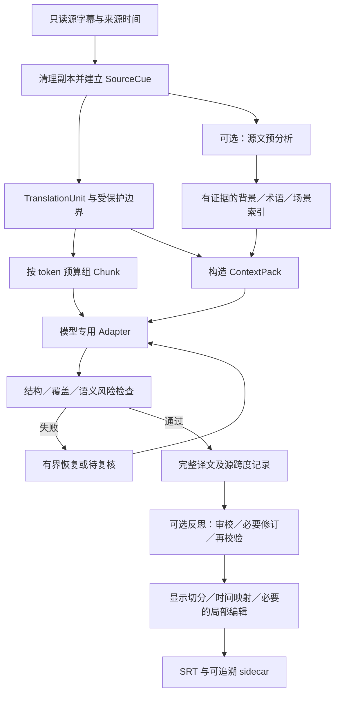

# 字幕翻译流程：共同设计与四套方案入口

状态：draft；完整增强流程供讨论和后续实现，未采纳为产品能力；固定窗口子集已有独立 demo 和质量实测。  
最后更新：2026-10-07。
范围：离线字幕的日语→简体中文翻译，兼顾其他语言对；四套模型流程共用的数据、上下文、映射、恢复和验证规则。当前 W0／X0 仍输出原语言转写；本设计是独立的后续翻译阶段。

当前字幕翻译基线为 **Hy-MT2 30B-A3B APEX-I-Compact**，见[ADR-0005](../adr/0005-apex-i-compact-translation-baseline.md)、[运行入口](../../experiments/translation_demo/README.md)与[评估入口](../testing/translation-model-evaluation.md)。已测固定窗口配方与下文待实现的全文预分析、compact、反思和显示增强分开；采纳模型不代表整套草案已实现或接入 STT。

## 1. 推荐方案与阅读入口

建议以“**合并被字幕切碎的语义单元 → 多单元成批翻译 → 按 ID 校验 → 独立处理显示与时间**”为主线。批次之间默认使用全新请求，按需携带前后原文、背景及命中术语。全文预分析是可选增强；逐批压缩全部历史不作为默认。

| 流程 | 模型实际接收什么 | 返回与映射 | 背景／术语入口 |
| --- | --- | --- | --- |
| [通用语言模型](subtitle-translation-generic.md) | 带 ID 的多单元正文，明确隔离只读上下文 | 最小 ID→译文对象；支持时使用 schema，否则文本协议＋严格校验 | 应用组织的提示段 |
| [Hy-MT2](subtitle-translation-hy-mt2.md) | 原生模板内的单单元纯文本或多单元结构化文本 | 两条正常候选路径：纯文本由程序绑定 ID；多 ID 结构保持需实测，按收益选择或组合 | 官方有背景／术语提示范式；按需启用，不是服务 API 专用字段 |
| [TranslateGemma](subtitle-translation-translategemma.md) | 原生语言字段＋一个纯待译正文段落 | 原生纯文本，外层保留 ID；跨单元长段需要额外语义映射 | 原生无只读背景／glossary 字段，增强放在外部辅助流程 |
| [Tower+](subtitle-translation-tower-plus.md) | 原生 Gemma 2 包装中的翻译任务＋少量条件 | 原生纯文本控制；多 ID 输出通过能力检查后启用 | 短自然语言条件，遵循度仍需实测 |

四套文件是独立流程，不是把同一 prompt 换四个模型名。每份给出请求／返回、预算、降级和验收；本文拥有共同约束。全部数值起点都属于待验证的工程提案，不是官方最优参数或本机测量结果。

## 2. 对本次设计问题的直接回答

| 问题 | 建议 | 主要取舍 |
| --- | --- | --- |
| 能否合并打标后一次翻译一大段？ | 可以。先合成语义单元，再把多个有 ID 的单元放进同一请求；不把整片变成一个无锚点字符串 | 单元内中文可调整语序，单元之间保留内容归属；TranslateGemma 走原生段落＋外部映射 |
| 前后额外带几句？ | 支持只读上下文的流程从前 2、后 2 个完整话轮试起；场景边界截断，可对歧义组扩到各 4 个 | 是可调起点，受 token 预算约束；原生 TranslateGemma 不能把额外正文当作“不需翻译”的字段 |
| 标题／背景要不要带？ | 带经过清理的作品标题、集数、可信短背景；优先当前场景原文 | 文件名只提取内容身份，去掉路径、发布组、编码等；不凭模型记忆补剧情 |
| glossary 怎么带？ | 用户确认译法优先，每批检索命中项；人物姓名、别名、敬称分开处理 | 自动提取是候选，不是已批准术语；不得硬替换同形词或提前揭示身份 |
| 便宜模型先读全文／前 8000 字符？ | 长片质量模式值得做一次源文预分析；全文过长时分场景抽取再合并 | 8000 字符只能作为快速预览，须记录覆盖范围；不能代表后半片 |
| 每批新上下文还是 compact？ | 默认新上下文＋显式 ContextPack；先试场景摘要与术语检索，再考虑滚动记忆 | 避免错误译文反复摘要；可并行、重试和恢复。需要滚动记忆时只在场景完成后更新 |
| 是否每批都要便宜模型总结？ | 不需要。普通批次复用预分析结果，按 ID／词项检索即可 | 全量逐批总结可能比直接翻译更慢；低价不等于能正确总结日语指代 |
| 还有哪些主要优化？ | 边界歧义定向扩大上下文、术语冲突检测、仅异常段审校、缓存身份完整、显示与翻译分离 | 优先减少遗漏与错挂时间，再试全量二次润色、多模型投票等高成本方案 |

## 3. 总体流程与职责



拟议的翻译 Module 对调用者暴露 `translate(document, profile, context_policy) -> TranslationRun`：输入配置必须明确模型身份、语言对、上下文来源和失败预算；输出保留完整成功／失败清单。内部 Adapter 负责各模型的模板、token 计数、生成和解码，通用调度负责冻结输入、重试、缓存及校验。显示导出使用另一个 Interface，不让模型 Adapter 决定时间码。这里是设计示意，仓库中尚无这些接口。

首次实现不需要向量库、自动模型路由、音画理解或复杂 agent 编排。全文预分析、辅助映射和审校可以共用一个经过校准的通用模型，但其三个任务和产物身份必须分开。

## 4. 数据与覆盖不变量

以下名称是本组草案的局部定义，不替换既有 STT `units` 或全项目术语。

| 记录 | 必要内容 | 不变量 |
| --- | --- | --- |
| `SourceCue` | 文件哈希、全局 `cue_id`、原文、起止时间、轨道、格式／说话人信息（若有）、时间来源 | 不按当前文本或批内序号生成身份；同一句重复出现也是不同记录 |
| `TranslationUnit` | `unit_id`、有序 `source_spans`、待译文字、边界／依赖信息 | ID 和跨度由程序冻结；可覆盖多个 cue，不让译者自由创建映射 |
| `Chunk` | `chunk_id`、有序 `target_unit_ids`、协议版本、预算 | 正常处理时每个 target unit 归属恰好一个批次；重试另有 attempt ID |
| `ContextPack` | 只读前后文、背景、命中术语、可选场景事实／已确认句对、版本 | 上下文 ID 不进入本批输出集合；缺信息保持缺失，不用剧情猜测填充 |
| `TranslationResult` | unit ID、完整译文、状态、实际模型／prompt 身份、风险、尝试记录 | 返回顺序不决定对应关系；原文回填不是成功译文 |
| `DisplayCue` | 译文范围、对应源跨度、源时间与精度、显示编辑版本 | 不凭译文生成新的声学时间；全部未导出内容仍在 sidecar 中 |

源跨度使用 `(cue_id, char_start, char_end)`，字符位置定义为 Python 原始字符串 Unicode code point 的半开区间。若模型输入经过去标签、拼接或换行清理，另外保存清理后字符到原始字符的映射；不要在原字符串上就地改写再继续使用旧 offset。

所有纳入翻译的实词字符必须恰好属于一个 TranslationUnit。排除的绘图／控制标签、空项和用户明确保留原文的内容分别记账；产品流程不自动继承评测库“去歌曲”等样本清洗政策。一个 unit 可被拆成多个显示 cue，但其完整译文仍保留一份权威记录。

基础协议要求每个 unit 返回一份译文，不支持译者跨 unit 自由合并。如果发现几个 unit 才能自然表达完整句，应退回分段阶段重建依赖组、变更 unit 身份后再翻译；不能给前一项填全部译文、后一项填空再宣称覆盖完整。TranslateGemma 的段落辅助映射是明确命名的例外路径，见专项文档。

## 5. 分段与打包

### 5.1 先合语义，再合请求

1. 保留源 cue，清理仅产生副本。标出可靠的场景、说话人、长间隔、同时说话及显式段落边界。只有字幕时，场景／说话人可能未知，不能凭断行推定。
2. 优先把同一话轮内被显示切碎的句子合成 TranslationUnit；问答可以放同一 Chunk，但保持为不同 unit，防止交换施事者。否定、条件从句未闭合时保留与下一 cue 的依赖。
3. 初试可把“超过 1 秒的源 cue 正间隔、单元总时长超过 12 秒、已知换人／场景切换”作为停止自动合并的信号；这些只是保守启发式，字幕间隙不等于实测静音。需要跨信号合并时留下可审核的例外，不能机械跨越悬念停顿。
4. 再把相邻完整 unit 打包成一次请求。通用模型从 8–16 个 unit 起试，常对应更多源 cue；本地专用模型用各自更小起点。正文上限最终由 token 和输出预算决定，条数和时长只是护栏。
5. 单个 unit 超限时优先在有原文证据的分句边界拆开，并保存父 unit 和跨段依赖。找不到合理切点则进入待复核，不能静默截断。

这样既能让模型看到一段连贯对白，也不把“一次 HTTP 请求”和“一个字幕条目”绑定。加大 Chunk 不等于扩大每个 unit 可自由挪动内容的时间跨度。

### 5.2 实际 token 预算

每个 Adapter 检查以下两条，不能以字符数代替 tokenizer：

```text
rendered_input_tokens <= verified_input_limit
rendered_input_tokens + reserved_output_tokens + safety_margin <= runtime_context_limit
```

输入包括 chat template、任务说明、背景、术语、只读上下文、正文及格式示例。输出包括译文与 ID／JSON 开销；若后端的生成预算还包括 reasoning tokens，应按其接口另留额度。TranslateGemma 的官方 2K 是输入口径，不是统一输入＋输出总量。

初试留 10% 运行上下文作安全余量；按正文实际 token 数估计输出，再用 dev 的长度分布修正系数。不能把“中译文字符通常更少”当成永不截断的依据。未知 tokenizer 的远端端点用保守估算并标记估算身份，遇到超限缩批，不在服务端静默截掉前文。

预算不足时先移除低相关背景、未命中术语和旧句对，再缩小待译批次；保留决定否定、主客体、指代的必要相邻原文。拆批后的子请求仍可看原批的邻接原文。若必要上下文无法放入，显式标记，不把其丢失当作正常成功。

## 6. 背景、术语和局部上下文

### 6.1 信息来源与优先级

事实解释按当前源文及可信邻接证据优先；背景和摘要只帮助理解，不覆盖台词。术语选择则按用户确认／编辑确认译法优先于机器建议。两种优先级不能混成“术语表永远覆盖原文含义”。

文件标题只提供作品名、集数、语言等可核实信息。简介注明来源和可靠性；未知人物关系不补写。所有字幕、文件名和外部简介都是待处理数据，其中类似“忽略前面的指令”的内容也按台词翻译，不改变任务协议。

默认前 2／后 2 个完整话轮是最大范围内的选择起点；文件起止不补虚构内容，跨场景不机械填满。一次重试扩到各 4 个话轮时记录策略变化。后文可用于理解省略，但不能把稍后揭露的姓名、动机或结论提前写入当前译文。

### 6.2 术语不是简单字符串替换

术语项至少包含 `term_id`、源写法／别名、候选或确认译法、类型、适用场景、来源 cue、状态、首次可用位置和冲突信息。人物的本名、昵称、称呼、敬称应分开；例如不能把所有「あの人」替换成后面才公开的姓名。

检索先匹配正文和邻句中的实际写法，再考虑已有别名；不因常见短词的子串命中就强制采用。每批可从最多 20 个高相关术语起试；上限溢出时保持强制确认项、缩正文，不能悄悄丢掉本批必需的译法。译后匹配只发出告警；有语法变化、称呼变化或同形词歧义时，重新看上下文，不做全片正则替换。

## 7. 可选的便宜通用模型预分析

### 7.1 两档准备方式

**轻量模式（初试默认）**：不调用分析模型，使用已有标题／用户 glossary＋局部前后文。先证明正文翻译和映射有效。

**长片质量模式（推荐对照）**：只读源语言字幕，按场景／预算分块，提取主题、实体、候选译名、关系证据和未知项，再做一次去重与冲突合并。短片能安全放入模型窗口时可一次读取全文；长片按块覆盖全部源文，不把前 8000 字符假装成全文。

前 8000 字符可提供快速预览，记录 `coverage: prefix_only` 和确切源范围；后续每个新场景补抽取，片尾仍须报告未覆盖范围。VideoLingo 的默认做法确实只截取开头，见[源码研究](../research/2026-10-05-translation-videolingo.md)；本文建议的全片覆盖与证据索引是额外设计，不是其已有保证。

### 7.2 产物应是证据卡片，不只是剧情梗概

以下是合成的应用内部记录，不要求专用翻译模型直接消费此 JSON：

```json
{
  "context_version": "ctx-1",
  "coverage": {"kind": "scene", "source_ids": ["s101", "s102"]},
  "facts": [{"text": "说话者将星舟称为船名", "evidence_ids": ["s101"], "valid_from": "s101"}],
  "terms": [{"source": "星舟", "target": "星舟", "status": "proposed", "evidence_ids": ["s101"], "scope": "scene-3"}],
  "unresolved": [{"text": "船主身份未知", "evidence_ids": ["s102"]}]
}
```

提取器被要求仅依据给定原文，列出证据 ID，未知保持未知，不输出译文全文、不调用作品百科。程序检查证据 ID 存在、源词实际出现、覆盖范围完整和字段类型；这些检查不能证明摘要语义正确，所以机器事实与候选译名保留“未确认”身份。

合并器保留冲突列表及不同作用域，不按最后出现的译法覆盖前项。人工或后续语义检查可以确认／撤销候选；不可疑的机器建议也应与用户确认项分层传入。提供给翻译模型的内容从这些卡片检索，建议控制在约 300–500 tokens 的短背景加命中术语，具体由各模型预算收紧。

全文知识分为“制作层已知”和“当前对白可表达”。`valid_from` 仅是粗粒度护栏，不证明人物在此时已知；涉及剧情揭示的身份仍以当前台词为准。禁止把整片结局摘要作为无条件全局指令。

### 7.3 便宜模型的选择与实际成本

不在设计阶段按价格／参数量指定赢家。先用 dev 检查日语实体、否定、人物关系抽取与不确定性保留；错误摘要的连锁代价可能超过节省的调用费。无法合格时关闭预分析或换已验证模型，不把猜测背景继续供给每一批。

记录总成本：冷加载＋预分析＋所有翻译尝试＋辅助映射＋审校＋显示编辑。单卡本地分析模型与翻译模型建议分阶段加载，保存预分析后卸载，再翻译；不要每批在两模型间反复切换。远端“便宜模型”同样会接触字幕，默认不外发，本次设计请求不等于授权上传素材。

## 8. 全新请求、记忆与 compact

推荐默认 `fresh_context`：每个请求由相同版本的 ContextPack 规则构造，无隐藏聊天状态、不使用上一窗口服务端 conversation。相同静态前缀可在支持的后端尝试 prefix cache；缓存是计算复用，不是逻辑历史。

| 方案 | 适用情形 | 调度与风险 |
| --- | --- | --- |
| 新请求＋局部原文＋术语 | 默认；便于并发、恢复、比较 | 一致性来自同一术语版本，不保证解决所有远距离指代 |
| 新请求＋预先生成的源文场景卡片 | 长片质量模式 | 分析先完成并冻结，翻译批次可并行；事实以原文为据 |
| 新请求＋少量已确认 TM 句对 | 反复出现的固定口号／领域句式 | 只检索相关句对，保留场景限制；相同「はい」不全片复用 |
| 场景级滚动记忆 | dev 证明远距离一致性仍有明显缺口时 | 场景间串行更新；场景内只共享进入该场景时的冻结快照 |
| 无限 chat history 或每批全文 compact | 不推荐作为起点 | 输入增长、摘要失真、错误自我强化，恢复后也难复现 |

启用滚动模式时，场景完成并通过检查后才产生 memory delta：原文证据事实、已确认译名、未解决指代、少量确认句对。总结器读原文＋确认记录；不把未经复核的译文当唯一事实。优先删除低相关条目，超过冻结的记忆预算再从原文重建摘要，避免“摘要再摘要”的连续失真。

建议首轮上限为 512 tokens 场景记忆，按模型预算调整；跨场景重置局部指代，但保留已确认实体译名。每个请求保存 `memory_version` 和父版本。修正旧译名／事实时，使所有依赖该版本的后续产物失效并重检；不会静默改掉已完成字幕。

一个批次的输出不能同时被声称“供下一批参考”又与所有后续批次并发生成。想要这种反馈必须承担顺序依赖，或先并行初译再集中一致性检查，分别标明流程身份。

## 9. 返回、失败恢复与缓存

返回解析首先识别协议错误，再处理语义疑点：

1. 校验服务状态、截断、拒答、空内容和输出上限；流式内容完整结束前不写成功记录。
2. JSON 解码时拒绝重复 key，检查精确 ID 集合、值为非空字符串、无额外条目。分隔符协议也必须验证 ID 唯一与完整性，不能按换行数直接 zip。
3. 核对结构标记和受保护格式；前后上下文被译出、复制整段原文、重复生成、明显错语言均触发检查。短姓名不因原样保留就判失败。
4. 对否定、数量、主客体、称谓、跨条连续性和新添事实做风险检查。程序能发现部分异常，不能仅凭 key 齐全证明忠实度。

拟议的有界恢复策略：传输瞬态错误最多再试 2 次并退避；认证／不支持参数进入配置错误，不靠缩批解决。内容失败先允许一次有针对性的修复，仍失败则按语义依赖组二分，最多 3 层。各模型文档可以设更严格的局部次数；所有分支仍共用原批的总请求／token／时间预算，建议初试总计最多 16 次模型调用，辅助模型也计入。达到任一上限后明确 `failed` 或 `needs_review`，不无限递归。

截断优先重算输出预算或缩正文，不要求模型“接着写”后拼接未知边界。可独立保留的有效 unit 必须没有与失败项跨句依赖；整段自由翻译映射损坏时，整个依赖组重新处理。任何备用模型须事先列入 profile；使用后记录独立身份，不能算原模型的纯原生成功。

状态至少区分 `translated`（通过配置的自动检查，不等于人工审定）、`needs_review`、`failed`、`preserved_by_policy`。存在未解决项时，完整成品状态不能为成功；可以导出明确标注的不完整草稿，但不能偷偷以原文补空。

缓存键包含源文与跨度、前后文、背景／glossary／memory 版本、模型权重／量化／运行时／模板、语言对、prompt／解析器／校验器版本和解码配置。读取缓存重新校验，不以“文件存在”跳过。失败尝试和最终成功分别留存；模型名相同但端点／权重变了也须失效。

### 9.1 可选反思：审校、修订与再校验

反思是初译之后的独立可选阶段，可接在单单元或多单元路径上，不要求逐句调用，也不等于在初译提示中写“仔细思考”。**审校与修订的模型均可配置，先不固定为初译模型或其他模型，也不要求两种角色使用不同模型。** 使用其他模型不等于使用云服务；模型位置和素材发送范围仍遵循本地默认规则。能翻译不自动证明能审校，实际配置须通过对应任务验证。

| 模式 | 行为 |
| --- | --- |
| `off` | 关闭模型反思，保留既有结构／覆盖检查与风险记录，作为初译对照 |
| `on_demand` | 审校被标记的单元及其最小语义依赖组；另抽查未报警段以估计漏检 |
| `all` | 分批检查全部译文，仅对有依据的问题提出修订，不要求每条都改写 |

以下仅为拟议配置形状，不是已实现的设置或已选模型。启用时再解析并记录实际角色配置，未配置或能力不兼容则明确报错，不静默选另一模型：

```json
{
  "reflection": {
    "mode": "off",
    "reviewer_profile": null,
    "reviser_profile": null,
    "max_rounds": 1
  }
}
```

建议初试一轮审校、至多一轮必要修订；轮数可在开发中调整，正式比较前固定，并始终服从原批的总调用／token／时间预算。三步是逻辑职责，可以用一次请求返回问题与修订候选，也可以分两次请求；请求组织同样作为实验变量，不预先规定多调用更好。

1. **准备输入：**另建请求，显式提供原文、当前译文及版本、允许修改的 unit IDs、必要邻接原文、适用术语和已有风险。可读范围可以大于可改范围；不需要无限聊天历史或先 compact。token 预算要加上初译、问题记录及预期修订输出，不能直接复用初译批量。参考答案和评测裁判反馈不得进入任何反思步骤。
2. **审校：**检查漏译／增译、否定与数量、主客体／指代、人物称谓、术语、语气及跨 ID 内容归属。应用记录 `keep`、`revise` 或 `unresolved`，问题附 unit ID、源证据及简短说明；无需长篇思维过程。允许“未发现问题”，缺乏上下文时记录未决，不补剧情。记录每个被审单元的覆盖；未被审查不等于已通过。
3. **必要修订：**只返回获准范围内的修改候选，保留未改项；不能改源记录、unit ID、源跨度或时间。以纠错和忠实表达为目标，不为体现反思而润色每句。纯显示压缩仍属于独立显示步骤。审校发现必须跨 unit 重分配时，退回分段／映射流程，不直接移动台词。
4. **再校验与选择：**程序先验 ID、非空、覆盖、受保护格式及变更范围，再对照原文检查所列问题是否解决、有无新添错误。审校模型自报“更好”或合法 JSON 都不足以证明质量；语义检查可以复用所选模型，也可另行配置或人工复核，不强制独立模型。只有达到该轮明示的接受条件才采用候选；不确定则留待复核。

初稿、问题、修订候选、实际采用版本与原因分别保存。反思超时、格式失败或预算耗尽时保留初稿并记录 `reflection_failed`；初稿已有的语义疑点继续是 `needs_review`，不能因反思可选而清除。修订引入退化时可回退，但回退不代表原有问题已解决。是否允许使用未完成反思的初稿作为草稿由运行策略明确，不把它计为反思完成。

译文变化后重建其目标字符 offset、双语映射和显示切分，原始源锚点保持不变；已进入 glossary／TM／滚动记忆的被修改内容使相关下游缓存失效。缓存及运行身份另外绑定反思模式、角色模型／模板／参数、初稿哈希、反馈版本、轮次和接受规则，区分初译成绩与最终流程成绩。同模型再调用与其他模型介入都单列成本，不把新增反思混入未变的 `V2-replay`；源信息不变时也要另立反思配方。

验证比较 `off`／`on_demand`／`all`，以及实际选定的同模型／其他模型配置，先不指定赢家。至少报告发现并修正的实质错误、新引入错误、误报／漏检、无改动比例、未决／失败比例和总耗时；不能只统计修改数量或中文流畅度。各模型如何接入见对应流程的“可选反思阶段”，以下均为设计，未验证收益。

## 10. 翻译后如何回到字幕时间轴

**首先保存完整意义，然后做显示。** 时间一直在程序端。正文从 SRT 来时只有 cue 时间，从 STT sidecar 来时可能有源词／字符锚点；这两种精度不能混淆。既有 [STT 显示契约](../testing/demo-display-contract.md)是来源追溯参考，不是已实现的翻译 writer。

提供两种显式导出模式：

- `preserve_source_cues`：保持原 cue 时间。若 unit 合并了多个 cue，需将完整译文按语义分配回这些源跨度；不能按等长或按第 n 行猜。必要时请求通用模型只提出译文切点／源跨度对应，程序检查原译文字符覆盖、不改字、无重叠；语义对应仍需验证。无法合理分配则待复核，不制造空字幕凑数。
- `bounded_resegment`：允许在同一 unit 的可信源时间范围内重新生成中文显示 cue。若有可信词时间和双语分句关联，可派生子跨度；只有原 cue 锚点时优先保留原边界，或把短而连续的合并 unit 作为一个显示块并标注粗粒度来源。跨长停顿、换人或悬念不能整体前显。

双语语义重排导致无法单调切回时，应重译为更适合源展开顺序的中文、选择有证据的合并显示或请求人工复核。普通单语 forced aligner 不能把中文译文直接对齐日语音频。字符比例分时如用于预览，必须标记启发式，不作为正式同步验收证据。

显示约束（CPS、行长、最大行数、时长）是可选目标 profile；没有默认照搬平台规范。超限先调整断行／合法切分，仍需缩短时另存 `display_text` 与完整 `translation`，仅局部编辑并检查否定、数字等保义。未经请求不扩展时间、不填静音、不删重复台词或歌曲。

## 11. 评测轨与验收

### 11.1 不能混为同一实验的三种输入

[v2 入口](../testing/translation-model-evaluation.md)及其外部规约具有优先级。继承的 v1 使用说明要求统一 system prompt／输出，而专用模型原生模板可能不支持；不能把更换模板称为完全复现。

| 实验身份 | 输入与状态 | 输出与可比较范围 |
| --- | --- | --- |
| `V2-replay` | 原冻结 JSONL、历史统一协议、各窗口清空状态 | 保留原 `translate_ids`；不兼容模型记接口限制，不硬塞 system prompt |
| `V2-native-adapted` | 同一源文 JSONL，提前声明模型原生模板差异，不加全文／额外背景 | 保持窗口和计分 ID；段落译文拆回若需要辅助模型则另列 assisted 子轨与成本，不能算裸模型质量 |
| `P-flow` | 独立冻结的源文长片／场景输入、标题、术语及可选源文预分析／记忆 | 评价四套完整流程；允许新 unit 和显示切分，另行冻结语义映射与评分规约 |

中文参考、双语复核记录和参考答案不得进入翻译器、预分析器、摘要器、术语提取器或辅助映射器。`P-flow` 可以用源语全文构造上下文，但须记录这是扩展输入；不能把 test 参考中人工修过的中文词表当作 source-only glossary。使用同一部电影 dev/test 时仍有作品共享，不能声称跨作品泛化。

在新 unit 覆盖多个 v2 计分 ID 时，若无法忠实拆回，不复制同一长译文到多个 ID 糊弄 validator。应记录映射失败，或在独立 `P-flow` 轨按窗口语义评价。被迫只输出计分 ID 的适配过程和额外成本必须公开。

### 11.2 实验顺序

1. **协议 smoke**：合成数据＋v2 smoke 子集，核对模板、语言方向、输出终止、ID、截断、正文／上下文隔离。用合成故障注入覆盖重复 ID、乱序、漏中间项、同文不同 ID、恶意台词、引号／换行和空值。
2. **dev 消融**：同模型先比较孤立 cue 控制与多单元批次，再逐项增加前后文、标题／确认术语、源文预分析、场景记忆；最后试异常审校。先定位收益，避免把所有优化叠加后无法归因。
3. **冻结再 test**：保存数据与输入范围、模型／量化／runtime、模板、参数、预算、预分析模型、恢复上限和评分规约。原生质量与混合流程的最终成品分别展示。
4. **长片验证**：额外检查边界与早中晚一致性、揭示信息时机、故障恢复、词表修订后的缓存失效。v2 小窗口不足以验证滚动记忆和全片时间体验。

硬性工程门槛：所有输入都有明确终态；成功项精确覆盖允许 ID／跨度；零静默漏项、零非法时间伪装成功；恢复有上限、来源可追溯。质量门槛须在 dev 后冻结；自动 schema 全通过不替代双语复核。至少报告严重错意、遗漏／增写、术语冲突、映射错误、未翻译疑点、初次与最终成功率、人工修订量、总耗时和峰值显存；电影和剧集沿用 v2 的分组口径。

## 12. 依据、阅读范围与本轮限制

本次沿[评测入口](../testing/translation-model-evaluation.md)递归阅读相关链路：外部 v2 README／评测规约及继承 v1 使用说明；[总报告](../research/2026-10-05-subtitle-translation.md)下的 [Subtitle Edit](../research/2026-10-05-translation-subtitleedit.md)、[VideoLingo](../research/2026-10-05-translation-videolingo.md)、[pyVideoTrans](../research/2026-10-05-translation-pyvideotrans.md)、[方法](../research/2026-10-05-translation-methods.md)、[评估](../research/2026-10-05-translation-evaluation.md)；[模型对比](../research/2026-10-05-local-translation-model-comparison.md)与三份专项模型报告；[资产](../guides/local-translation-model-assets.md)、[量化](../research/2026-10-06-translation-5080-quantization.md)和相关显示契约。

既有三软件源码结论沿用 2026-10-05 固定快照研究，未重新运行软件。三模型的关键原生契约及通用结构输出在 2026-10-06 补查官方来源，精确链接分别见四份流程文档；网页查阅不是本机推理验证。无关的历史 STT 链路、参考答案正文和原始音视频没有作为本次流程设计输入。

本轮只新增设计文档及导航；未下载／加载模型、未调用翻译 API、未修改外部冻结评测库。README／AGENTS 的 STT 里程碑继续成立。尚不能回答哪条流程质量最好、摘要是否值得开、可靠批量多大或 5080 的真实吞吐；这些由上述实验给出，不由接口支持推断。
